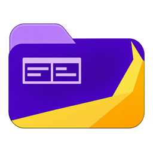
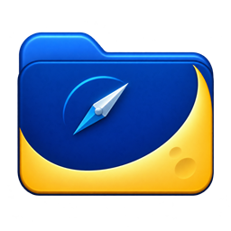
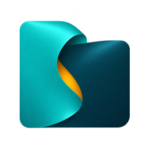

# Midnight Explorer application icon

A moon with a silver illuminated half and a midnight-blue shaded half. The
transparent background works on both light and dark desktops. This is application
branding; file and drive icons continue to come from the operating system.

- `moon-master.png`: original generated artwork, retained for future exports.
- `midnight-explorer.png`: 256-pixel window icon, embedded by Slint. On Wayland,
  the compositor uses the installed desktop entry and this PNG instead; see the
  [Linux launcher instructions](../../README.md#linux-desktop-launcher).
- `midnight-explorer.ico`: Windows executable icon with 16, 20, 24, 32, 40, 48, 64,
  128 and 256-pixel frames. Embedded at build time using the Windows SDK resource
  compiler; the application does not need to load an external icon file at runtime.

The assets were created with the built-in image generation tool on 2026-11-06;
the exact prompts are retained in [PROMPT.md](PROMPT.md).
The generation brief was a centered full moon with roughly equal light silver and
dark slate-blue sides separated by a gently curved vertical boundary, restrained
crater shapes, a transparent background, clear small-size readability, and no text
or additional objects. A second pass requested a cleaner outer silhouette while
preserving the moon and shading.

To regenerate the size exports on Windows, run `powershell -NoProfile -File
scripts/build-app-icon.ps1` from the repository root. This only scales and packages
the committed master; it does not call an image service. Normal project builds on
Windows and Linux use the committed exports and do not run this maintenance step.
No intermediate artwork is written outside `_build`; the three files here are
intentional source assets. Future macOS application packaging can derive ICNS
sizes from the same master once that platform is implemented.

## Icon shortlist

Choose a design in **Options → Appearance → Application icon**. Midnight Moon is
the default. Selecting a design previews it on the toolbar and in app windows.
Choose **OK** to keep it across launches or **Cancel** to restore the saved icon.
Windows and X11 support per-window icons. On Wayland the shell uses the icon from
the installed desktop entry. Windows shortcuts can also have their own icon.

| Preview | Icon | Design | Files |
| --- | --- | --- | --- |
|  | Origami Trail | A purple folder with a gold fold frames two lavender file panes beneath a shared title bar. | [PNG](variants/origami-trail/midnight-explorer.png) · [Windows ICO](variants/origami-trail/midnight-explorer.ico) |
|  | Harvest Navigator | A silver-and-blue compass needle and gold crescent sit on a deep blue folder with Dodger Blue highlights. | [PNG](variants/harvest-navigator/midnight-explorer.png) · [Windows ICO](variants/harvest-navigator/midnight-explorer.ico) |
|  | Interleave | Two overlapping teal folds suggest paired panes. A narrow gold crescent appears where they meet. | [PNG](variants/interleave/midnight-explorer.png) · [Windows ICO](variants/interleave/midnight-explorer.ico) |

To use a design on a Windows desktop shortcut, open **Properties → Shortcut →
Change Icon** and select its ICO file. To rebuild a design’s PNG and ICO from
its `master.png`, run the export script from the repository root with its folder
name. For example, to rebuild Origami Trail, run
`powershell -NoProfile -File scripts/build-app-icon.ps1 -Variant origami-trail`.
