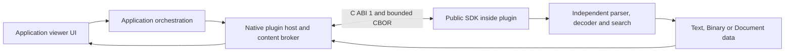

# Developer guide: public plugin API

Midnight Explorer loads independent native viewer plugins through C ABI 1.0.
The public Rust packages are `midnight-plugin-api` and `midnight-plugin-sdk`,
currently version `0.1.0`. The application loader, content broker, viewer window,
and Basic, Source and Markdown plugins are implemented. Windows x64 and Linux
x64 have native integration coverage. This guide describes that implementation;
the versioned draft API has not yet made a long-term compatibility commitment.

Start with [building and installing a plugin](QUICK_START.md), then read the
[ABI and lifecycle contract](ABI_AND_LIFECYCLE.md) and the
[viewer protocol reference](VIEWER_PROTOCOL.md). The
[SDK contract](../../api/midnight-plugin-sdk/README.md) is a shorter author-facing
reference; its packaged introduction records the earlier pre-loader milestone
and is preserved to keep released archive checksums stable. Current integration
status is described here. The [public C header](../../api/midnight-plugin-api/include/midnight_plugin_v1.h)
and [Rust API source](../../api/midnight-plugin-api/src/lib.rs) define the actual
symbols; illustrative future types in design documents are not public exports.

Executable filesystem, image/PDF-viewer and thumbnail plugins use separate public protocols and
restricted processes. See the [filesystem API](FILESYSTEM_API.md) and
[worker/thumbnail SDK](WORKER_SDK.md) and [image viewer API](IMAGE_VIEWER_API.md);
they do not change the released viewer ABI.

Application contributors working on copy and archive extraction should also read
the internal [native transfer contract](TRANSFERS.md). Its Rust capabilities are
not part of the external plugin ABI.

The [filesystem migration map](FILESYSTEM_MIGRATION.md) and
[internal provider registry](PROVIDER_REGISTRY.md) describe the transitional
Browse/Read adapters and remaining native-plugin cutover. Internal Rust traits
are not an alternative public plugin dependency.

The internal [recursive Find contract](FIND.md) documents bounded sessions,
native content traversal, modeless UI ownership and safe result navigation.
The [checksum contract](CHECKSUMS.md) describes captured calculation, results,
export and cancellation. [Panel selection](SELECTION.md) documents immutable
selection provenance and rectangle input across native and archive views.
The [Custom Commands contract](USER_COMMANDS.md) covers native argv/templates,
captured configuration, previews, process ownership and cancellation. These
application services remain separate from independently developed plugin APIs.

## Architecture and ownership

The host owns file authority, native handles, worker scheduling, windowing,
selection, clipboard, fonts and themes. Plugins own decoding, parsing, indexing,
search and bounded caches. A plugin returns semantic data, never Slint objects,
executable markup, a GUI event loop, a Tokio runtime, or Rust trait objects across
the ABI. Source mode uses the Text model with semantic styles.

One Git repository contains **separate Cargo workspaces**:

| Location | Responsibility | Dependency boundary |
| --- | --- | --- |
| `Cargo.toml`, `crates/` | Application, engine, UI, native host and platform services | Internal application crates |
| `api/Cargo.toml` | Public ABI, schemas, SDK and maintainer packaging/header tools | No application crates or concrete parsers |
| `filesystem-api/Cargo.toml` | Read-only executable filesystem protocol | Versioned public wire definitions; no application crates |
| `worker-api/Cargo.toml` | Restricted executable startup SDK | Public platform containment contract |
| `thumbnail-api/Cargo.toml` | Brokered media reads and bounded RGBA frame protocol | Independent public API/SDK; no application crates |
| `image-viewer-api/Cargo.toml` | Raster image/document protocol and SDK 0.2.0 | Versioned public page metadata and bounded viewport messages |
| `plugins/midnight-thumbnail-image/`, `plugins/midnight-thumbnail-video/` | Image and video frame decoding | Released thumbnail/worker SDK and plugin-owned codecs/tests |
| `plugins/midnight-fs-archive/` | ZIP, 7z, TAR and GZIP/XZ/BZIP2/Zstandard streams and TAR wrappers | Released filesystem API and worker SDK plus plugin-owned parsers |
| `plugins/midnight-viewer-image/`, `plugins/midnight-viewer-pdf/` | Restricted image decoding and PDF rendering | Released raster/worker SDKs and plugin-owned tests/codecs |
| `plugins/midnight-viewer-basic/` | Text/Binary decoding and search | Released public SDK plus plugin-owned dependencies |
| `plugins/midnight-viewer-source/` | Source scanning and styles | Its own workspace, lockfile, dependencies and tests |
| `plugins/midnight-viewer-markdown/` | Semantic Markdown | Its own workspace, lockfile, dependencies and tests |
| `plugins/viewer-conformance/` | Independent native C ABI fixture | Released public SDK; not a user-facing viewer |

A plugin must build and test from an exported directory without application
sources. Depend on released, versioned API/SDK packages, not source paths,
`[patch]` overrides, internal host/platform/UI crates, another plugin, or private
shared helpers. Plugin tests and CI belong to the plugin package. Plugin builds
may install their own package; they must never patch application source or another
plugin. Reading a reference implementation does not make it a linkable dependency.
All third-party dependencies must satisfy the project's
[dependency policy](../DEPENDENCY_POLICY.md), including no required licence
fees for the intended use and distribution. That policy does not assign a licence
to the project's own API/SDK code.

## Discovery and trust

Only direct packages in `viewers/<package>/` inside the **resolved installation**
are discovered. Normally this is the actual executable's directory; shared
Windows builds can use an explicitly registered private copy with an identical
host hash. See [runtime discovery](RUNTIME_DISCOVERY.md). The current working
directory is not the plugin root. A package contains `plugin.toml`, its native library and distribution
notices. The directory name need not equal the manifest ID. Discovery reads
metadata without loading code; first use loads and checks the ABI descriptor.
Duplicate IDs disable all packages with that ID and produce diagnostics.

Extension matches are case-insensitive. Matching Document mode wins over Source,
then Text; manifest priority breaks ties within that ranking. A Text plugin with
no extensions is the generic fallback and explicit basic choice. Binary mode is
supported by the basic viewer and explicit mode changes, rather than being an
extension-routing preference. Disabled IDs are filtered using the application's
startup settings. No concrete plugin ID or parser is hardcoded into the loader.

Native plugins are trusted code running with the application's privileges.
Manifest validation, pointer metadata checks and scheduling budgets are not a
sandbox. Install only code you trust. The installation, package, manifest and
entry library must resolve to their expected canonical locations; redirections
and insecure ownership/write permissions are refused at discovery or first load.

Linux accepts current-user/root ownership and rejects group/other writes,
including unsafe ancestors; a trusted-owned sticky ancestor can be allowed.
Windows validates owner and DACL rights against the process user, System,
Administrators and the OS-resolved TrustedInstaller identity, including ancestor
rights that could replace installation objects. Use a private installation with
safe ancestors; a broadly writable build/share directory can be unsuitable even
when the DLL itself is read-only. See the
[native host reference](../../crates/midnight-plugin-host/README.md) for details.

Windows uses an absolute library path and restricted DLL search flags; Linux uses
absolute `dlopen` with `RTLD_NOW | RTLD_LOCAL`. Successfully loaded libraries are
pinned for the process lifetime, at most 256 canonical entry paths. Closing a
viewer destroys its instance only after quiescence; it does not unload the library.
Install, remove or replace packages with the application stopped, then restart.
A loaded path whose manifest ID/version changes is refused until restart.

Supported, integration-tested native targets are `x86_64-pc-windows-msvc` and
`x86_64-unknown-linux-gnu`. Discovery also recognizes
`aarch64-unknown-linux-gnu`; that recognition is not evidence of the same release
validation. macOS loading, signing and native identity handling remain future work.

## Content identity and Unicode

The host retains native `PathBuf`/OS identity internally. `Open.display_name` is
UTF-8 display text, possibly lossy, and never authorizes opening an OS path. Read
through the opaque reader ID supplied in `Open`; do not reconstruct a path from a
display label. Neither decoded text nor breadcrumb labels replace native identity.

The current local-file broker captures identity/metadata, then opens a read-only
regular-file handle for the session and validates it against that capture. Each
read checks identity, length and change/write timestamps before and after reading.
This guarantee is **LiveValidated**, not an immutable snapshot. A detected change
fails the read; consumers must not mix content from different revisions. Final
symlinks, reparse files and special files are refused by the native open policy.

Source positions and lengths are checked `u64` byte offsets. Decoded text indexes
are `u32` UTF-8 byte boundaries. Neither is a character count, UTF-16 index, line
number or screen coordinate. The decoder supplies exact source anchors; only
listed boundaries are exact. See [source mappings](VIEWER_PROTOCOL.md#source-mappings).

## Filesystem/provider API status

The [read-only filesystem worker API](FILESYSTEM_API.md) is implemented as the
separate `midnight-filesystem-api` package `0.1.0`, executable protocol 1. Independent
archive workers use the [worker SDK](WORKER_SDK.md), exchange bounded source/list/read
messages through pipes, and integrate with pane navigation, persistent tabs and
F3 content leases. The reference plugin supports ZIP, GZIP, TAR/TAR.GZ and 7z.
Missing packages remove that capability. See the API reference for exact limits,
identity rules, installation, errors and independent builds.

`KIND_FILESYSTEM = 2` in the viewer C ABI remains a reserved kind; executable
filesystem workers do not use that loader. General native/network providers,
credentials, extraction and mutation remain future public contracts. Internal
Rust mount traits are application implementation details, not plugin exports.

Accepted direction and future requirements are recorded in the
[dynamic viewer/filesystem design](../superpowers/specs/2026-11-05-dynamic-viewer-filesystem-plugins-design.md),
[viewer/VFS design](../superpowers/specs/2026-11-04-viewer-vfs-design.md) and
[network filesystem design](../superpowers/specs/2026-11-05-network-filesystem-design.md).
They cover independent native providers and archive/network providers, opaque
identities, capability reporting and content leases. The initial archive direction
is read-only browsing/reading; extraction, verified copying and mutation need
their own later contracts. The
[viewer implementation extension](../superpowers/specs/2026-11-05-viewer-implementation-extension.md)
records the implemented viewer scope and its deviations from earlier staging.

## Application internals are a separate development surface

For application contributors, `midnight-core` holds internal commands, events and
service traits; `midnight-engine` coordinates backend work; `midnight-plugin-host`
adapts native plugins; `midnight-ui`/`midnight-viewer-ui` render UI; and
`midnight-platform` selects the Windows/Linux platform implementation. Common
settings, native path persistence, fonts and local services live in
`midnight-platform-common`. Local browsing still uses those built-in adapters;
it has not been converted into the planned dynamic native filesystem provider.

These are internal Rust APIs that may change with the application. A public
viewer must not import them, even when a useful helper appears reusable. Propose
a versioned public API addition when an independent plugin needs a new host
capability. Do not bypass the boundary by adding an application dependency.

## Source map and verification

| Contract | Authoritative implementation |
| --- | --- |
| C table layout and status/kind constants | [abi.rs](../../api/midnight-plugin-api/src/abi.rs) |
| Wire validation and encode/decode | [wire.rs](../../api/midnight-plugin-api/src/wire.rs), [codec.rs](../../api/midnight-plugin-api/src/codec.rs) |
| Requests and content replies | [messages.rs](../../api/midnight-plugin-api/src/messages.rs) |
| Semantic text/binary/document models | [viewer.rs](../../api/midnight-plugin-api/src/viewer.rs), [document.rs](../../api/midnight-plugin-api/src/document.rs) |
| Safe author API and continuations | [plugin.rs](../../api/midnight-plugin-sdk/src/plugin.rs), [runtime.rs](../../api/midnight-plugin-sdk/src/runtime.rs) |
| Manifest discovery and selection | [discovery.rs](../../crates/midnight-plugin-host/src/discovery.rs) |
| File revision validation | [content.rs](../../crates/midnight-plugin-host/src/content.rs) |
| Native lifetime and dispatch | [loaded.rs](../../crates/midnight-plugin-host/src/loaded.rs), [dispatch.rs](../../crates/midnight-plugin-host/src/dispatch.rs) |

Integration evidence is in [viewer implementation verification](../verification/viewer-implementation.md)
and [public API/SDK verification](../verification/plugin-api-sdk.md). The latter
records the earlier isolated SDK gate; its test counts are historical, not a
replacement for current workspace checks.
