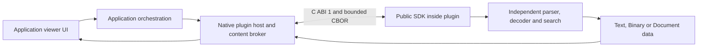

# Developer guide: public plugin API

Midnight Explorer loads independent native viewer plugins through C ABI 1.0.
The public Rust packages are `midnight-plugin-api` 0.2.0 and `midnight-plugin-sdk`
0.2.1; plugins built on SDK 0.1.0 or 0.2.0 load unchanged. The
application loader, content broker, viewer window, and Basic, Source and Markdown
plugins are implemented. Windows x64 and Linux x64 have native integration coverage.
This guide describes that implementation; the versioned draft API has not yet made a
long-term compatibility commitment. The [document index](#document-index) lists every
developer document, and the [glossary](../glossary.md) defines project terms such as
[plugin](../glossary.md#plugin), [worker](../glossary.md#worker) and
[lease](../glossary.md#lease).

Start with [building and installing a plugin](quick-start.md), then read the
[ABI and lifecycle contract](abi-and-lifecycle.md) and the
[viewer protocol reference](viewer-protocol.md). The
[SDK contract](../../api/midnight-plugin-sdk/README.md) is a shorter author-facing
reference; its packaged introduction records the earlier pre-loader milestone
and is preserved to keep released archive checksums stable. Current integration
status is described here. The [public C header](../../api/midnight-plugin-api/include/midnight_plugin_v1.h)
and [Rust API source](../../api/midnight-plugin-api/src/lib.rs) define the actual
symbols; illustrative future types in design documents are not public exports.

Executable filesystem, image/PDF-viewer and thumbnail plugins use separate public protocols and
restricted processes. See the [filesystem API](filesystem-api.md) and
[worker/thumbnail SDK](worker-sdk.md) and [image viewer API](image-viewer-api.md);
they do not change the released viewer ABI.

The [interactive web viewer API](WEB_VIEWER_API.md) is a separate bounded process
contract for the optional Chromium HTML provider. It carries owned frames and
input, with captured resource capabilities and explicit document permissions.
It neither extends the semantic C ABI nor weakens the image decoder sandbox.

The shared [pixel-scrolling contract](scrolling.md) covers panel/list wheel input,
scrollbar ownership, bounded rendering and native frame measurements.

The internal [native icons contract](native-icons.md) describes the device-pixel
edges icons are drawn at, the Windows and Linux providers that render them at
those edges, and where a listed program's own artwork is read.

The internal [viewer scrolling contract](viewer-scrolling.md) describes immediate
pointer feedback, bounded position queues, content acknowledgements and native
latency measurement. These UI/engine messages are not part of the plugin ABI.
The [file comparison contract](file-comparison.md) describes automatic panel
pairing, manual File A / File B choice, native picking and cancellation.
[Compare directories](compare-directories.md) describes the panel comparison's
criteria, content reads, subfolder walk, limits and cancellation.

Application contributors working on copy and archive extraction should also read
the internal [native transfer contract](transfers.md). Its Rust capabilities are
not part of the external plugin ABI. The shared [operation progress contract](operation-progress.md)
covers Copy/Move/Delete discovery, pause, cancellation, truthful progress and the
separate session ledger behind the [Jobs](../glossary.md#jobs) list. The internal [engine ownership contract](engine-lifetime.md)
describes runtime-independent retirement, bounded reservations and remaining actor boundaries.

The [filesystem migration map](filesystem-migration.md) and
[internal provider registry](provider-registry.md) describe the transitional
Browse/Read adapters and remaining native-plugin cutover. Internal Rust traits
are not an alternative public plugin dependency.

The [Network Neighborhood contract](network-filesystem.md) describes the independent
Windows/Linux discovery plugin, explicit share activation, opaque saved tabs,
bounded background enumeration and the separate later macOS adapter.

The internal [recursive Find contract](find.md) documents bounded sessions,
native content traversal, modeless UI ownership and safe result navigation.
The [checksum contract](checksums.md) describes captured calculation, results,
export and cancellation. [Panel selection](selection.md) documents immutable
selection provenance and rectangle input across native and archive views.
The [Make File List service](make-file-list.md) exports immutable listing metadata,
uses verified output staging and passes private generated content to the viewer.
The [Custom Commands contract](user-commands.md) covers native argv/templates,
captured configuration, previews, process ownership and cancellation. These
application services remain separate from independently developed plugin APIs.

## Document index

| Document | Purpose |
| --- | --- |
| **Plugin APIs and SDKs** | |
| [Quick start](quick-start.md) | Build, test and install an independent viewer plugin; its example is in [examples/tiny-viewer](examples/tiny-viewer/Cargo.toml). |
| [ABI and lifecycle](abi-and-lifecycle.md) | The viewer C ABI 1.0: exported table, instance lifecycle and threading. |
| [Viewer protocol](viewer-protocol.md) | Viewer requests, replies, schemas and source mappings. |
| [SDK contract](../../api/midnight-plugin-sdk/README.md) | The author-facing summary packaged with `midnight-plugin-sdk`. |
| [Runtime discovery](runtime-discovery.md) | How the application resolves and trusts its installed plugin runtime. |
| [Archive worker API](filesystem-api.md) | The read-only archive worker API, its protocols, limits and identities. |
| [Native filesystem plugins](native-filesystem-api.md) | The native filesystem plugin C ABI for browsing, reading, volumes and prepared Rename. |
| [Network Neighborhood](network-filesystem.md) | The network discovery plugin, share activation and saved locations. |
| [Worker SDK](worker-sdk.md) | Startup and containment of restricted worker processes, and the thumbnail protocol. |
| [Image and PDF viewer API](image-viewer-api.md) | The restricted image and paginated document viewer API and SDK. |
| [HTML viewer](WEB_VIEWER_API.md) | The interactive HTML viewer's process protocol, permissions and resources. |
| **Application internals** | |
| [Limits](../limits.md) | Every limit, budget and cap of the application, with its source constant. |
| [Engine lifetime](engine-lifetime.md) | Engine ownership, retirement and cleanup capacity. |
| [Provider registry](provider-registry.md) | The internal filesystem provider registry, mounts and content adapters. |
| [Filesystem migration](filesystem-migration.md) | Which consumers reach files through providers and which still use platform services. |
| [Content reads](content-reads.md) | Host content reads, revision checks and change-time drift. |
| [Transfers](transfers.md) | The native transfer service: verified Copy, Move, links, conflicts and limits. |
| [Transfer options](transfer-options.md) | The Copy and Move dialog options. |
| [Operation progress](operation-progress.md) | Progress windows, Jobs, pause, cancellation and admission. |
| [Disk operations](disk-operations.md) | The disk-I/O concurrency contract. |
| [Real operation QA](operations-real-qa.md) | The real Windows operation tests (`operations_real_windows`). |
| [Tree panel](tree-panel.md) | Inline branches in the panel: actions, watches, filters and sorting. |
| [Inline trees](inline-trees.md) | The backend branch model and its budgets. |
| [Selection](selection.md) | Rectangle selection in the panels. |
| [Parent navigation](parent-navigation.md) | Returning to a parent folder with the cursor on the folder left. |
| [Path paste](path-paste.md) | Pasting folder paths into the path editor. |
| [Panel diagnostics](panel-diagnostics.md) | The panels' diagnostic icons and their details, watch status and free-space refresh. |
| [Metadata filters](metadata-filters.md) | Panel metadata expressions: syntax and limits. |
| [Filename colors](filename-color-options.md) | Filename color rules and their priority editor. |
| [Native icons](native-icons.md) | How icons are drawn at device-pixel sizes on Windows and Linux. |
| [Pixel scrolling](scrolling.md) | Pixel scrolling of panels and text views, and the prepared text window. |
| [Viewer scrolling](viewer-scrolling.md) | Viewer pointer feedback, position queues and latency measurement. |
| [Viewer presentation](viewer-presentation.md) | Source and Markdown presentation: line numbers, fonts, Find and refills. |
| [Viewer preferences](viewer-preferences.md) | Viewer choices and how they are saved and restored. |
| [File comparison](file-comparison.md) | File comparison: pairing, File A and File B choice, byte comparison. |
| [Compare directories](compare-directories.md) | Directory comparison: criteria, content reads and limits. |
| [Find](find.md) | The recursive Find service and its windows. |
| [Checksums](checksums.md) | Checksum calculation, verification and export. |
| [Make File List](make-file-list.md) | The Make File List services. |
| [Custom Commands](user-commands.md) | The Custom Commands backend: arguments, templates and processes. |
| [Custom Command settings](user-command-settings.md) | The Custom Commands page of Options. |
| [Dialog ergonomics](dialog-ergonomics.md) | Dialogs, settings forms and their keyboard handling. |
| [Updates](updates.md) | The update check: protocol, signatures, staging, the installation swap, rollback and the release key. |
| **Testing and workflow** | |
| [Test execution](test-execution.md) | Validation scripts, CI jobs and parallel targeted tests. |
| [Acceptance suite](acceptance.md) | The opt-in end-to-end acceptance suite: running it, fixtures and scenarios. |
| Acceptance records: [panels](acceptance/panels.md), [transfers](acceptance/transfers.md), [Find](acceptance/find.md), [viewers](acceptance/viewers.md), [Options and keyboard](acceptance/options-tools.md), [tools](acceptance/tools.md), [journeys](acceptance/journeys.md), [UI polish](acceptance/ui-polish.md), [Windows run](acceptance/windows.md) | Each check of an area, its scenario and its latest recorded status. |
| [Agent workflow](agent-workflow.md) | Roles and the working agreement for coordinated development. |

## Architecture and ownership

This diagram and the ownership paragraph that follows it describe the semantic native
viewer C ABI 1.0. Image/PDF, thumbnail, archive and HTML process providers use their
[separate protocols and hosts](#discovery-and-trust).

For the semantic native viewer ABI, the application host owns file authority,
native handles, backend scheduling, windowing, selection, clipboard, fonts and
themes. Native viewer plugins own decoding, parsing, indexing, search and bounded
caches. They return semantic data, never Slint objects, executable markup, a GUI
event loop, a Tokio runtime, or Rust trait objects across this ABI. Source mode
uses the Text model with semantic styles.

One Git repository contains **separate Cargo workspaces**:

| Location | Responsibility | Dependency boundary |
| --- | --- | --- |
| `Cargo.toml`, `crates/` | Application, engine, UI, native host and platform services | Internal application crates |
| `api/Cargo.toml` | Public ABI, schemas, SDK and maintainer packaging/header tools | No application crates or concrete parsers |
| `filesystem-api/Cargo.toml` | Archive worker protocol and native filesystem API/SDK | Separate public wire and C ABI contracts; no application crates |
| `worker-api/Cargo.toml` | Restricted executable startup SDK | Public platform containment contract |
| `thumbnail-api/Cargo.toml` | Brokered media reads and bounded RGBA frame protocol | Independent public API/SDK; no application crates |
| `image-viewer-api/Cargo.toml` | Raster image/document API 0.4.0 and SDK 0.5.0 | Versioned public page metadata, bounded viewport messages and sanitized failure reasons |
| `web-viewer-api/Cargo.toml` | Interactive web viewer API and SDK 0.4.0 | Bounded frame/input process protocol; no third-party dependencies |
| `plugins/midnight-thumbnail-image/`, `plugins/midnight-thumbnail-video/` | Image and video frame decoding | Released thumbnail/worker SDK, the shared image decoder (images) and plugin-owned codecs/tests |
| `plugins/midnight-fs-archive/` | ZIP, 7z, TAR and GZIP/XZ/BZIP2/Zstandard streams and TAR wrappers | Released filesystem API and worker SDK plus plugin-owned parsers |
| `plugins/midnight-filesystem-native-windows/`, `plugins/midnight-filesystem-native-linux/` | Native Browse/Read, metadata, volume, storage and prepared Rename libraries | Public filesystem plugin API/SDK 0.2.0 as path packages from `filesystem-api/`, plus OS bindings |
| `plugins/midnight-filesystem-native-macos/` | macOS library for the same ABI, without prepared Rename | Same public API/SDK and pinned libc; type-checked and linted for both Darwin targets; never run on macOS, packaged or loaded by the host |
| `plugins/midnight-filesystem-network/` | Network Neighborhood discovery and share activation | Public filesystem plugin API/SDK path packages plus Windows WNet (windows-sys) or Linux GIO loaded at runtime through libloading |
| `plugins/midnight-viewer-image/`, `plugins/midnight-viewer-pdf/` | Restricted image decoding and PDF rendering | Released raster/worker SDKs, the shared image decoder (images) and plugin-owned tests/codecs |
| `plugins/image-decoder/` | Shared bounded image codecs | Path dependency of the image viewer and image thumbnail workers; not a public API |
| `plugins/midnight-viewer-html/` | Optional Chromium ([CEF](../glossary.md#cef), the Chromium Embedded Framework) HTML provider | Released web viewer API 0.4.0 and pinned CEF bindings |
| `plugins/midnight-viewer-basic/` | Text/Binary decoding and search | Released public SDK plus plugin-owned dependencies |
| `plugins/midnight-viewer-source/` | 25 lexical profiles, including XML/XAML/MSBuild, CSS, Makefiles and CSV/TSV; bounded scanning and styles | Its own workspace, lockfile, dependencies and [syntax/viewport tests](../../plugins/midnight-viewer-source/README.md) |
| `plugins/midnight-viewer-markdown/` | Semantic Markdown | Its own workspace, lockfile, dependencies and tests |
| `plugins/viewer-conformance/` | Independent native C ABI fixture | Released public SDK; not a user-facing viewer |

A plugin must build and test from an exported directory without application
sources. Depend on released, versioned API/SDK packages, not source paths,
`[patch]` overrides, internal host/platform/UI crates, another plugin, or private
shared helpers. Current in-repository exceptions: the native filesystem and Network
Neighborhood plugins take the unpublished filesystem plugin API/SDK from
`filesystem-api/` by path, and the image viewer and image thumbnail workers share
`plugins/image-decoder` by path and patch `image` from `vendor/image`. Plugin tests
and CI belong to the plugin package. Plugin builds may install their own package;
they must never patch application source or another plugin. Reading a reference
implementation does not make it a linkable dependency.
All third-party dependencies must satisfy the project's
[dependency policy](../dependency-policy.md), including no required license
fees for the intended use and distribution. That policy does not assign a license
to the project's own API/SDK code.

## Discovery and trust

Only direct viewer packages in `viewers/<package>/` inside the **resolved
installation** are discovered. Normally this is the actual executable's directory;
shared Windows builds can use an explicitly registered private copy. By default a
protected launcher pointer for the build's `midnight-explorer.exe` path selects it while that
executable keeps the size and modification time recorded at deployment, which
checked the copy's SHA-256 against the build; `MIDNIGHT_VERIFY_RUNTIME_SHA256=1`
instead requires the running host and the registered copy to have the same SHA-256.
Without a registration, a shared installation (one that other accounts can change
only through permissions) discovers its own packages and is reported once; release
packages never need a registration. See [runtime discovery](runtime-discovery.md).
The current working directory is not the plugin root. A native viewer package contains
`plugin.toml`, its native library and distribution notices. The directory name
need not equal the manifest ID. Native discovery reads metadata without loading
code; first use loads and checks the ABI descriptor. Duplicate IDs disable all
native packages with that ID and produce diagnostics.

A viewer package with `image-viewer.json` or `web-viewer.json` as its sole transport
manifest is delegated to the matching process host. Mixed transport manifests
remain unavailable and diagnostic; catalog discovery does not load or launch
plugin code. See the [native host reference](../../crates/midnight-plugin-host/README.md).

The application uses both library and process hosting:

- Basic, Source and Markdown viewers are native in-process libraries (DLLs on
  Windows, shared objects on Linux). Native and Network Neighborhood filesystem
  providers also use in-process libraries through their separate
  [filesystem ABI](native-filesystem-api.md) and [network contract](network-filesystem.md).
- [Image/PDF viewers](image-viewer-api.md), [thumbnail decoders](worker-sdk.md) and
  [archive filesystem providers](filesystem-api.md) run as process workers.
- [HTML](WEB_VIEWER_API.md) is process-hosted CEF. On Windows its bootstrap EXE
  loads the same-basename client DLL inside the helper process.

Extension matches are case-insensitive. Matching Document mode wins over Source,
then Text; manifest priority breaks ties within that ranking. A Text plugin with
no extensions is the generic fallback and explicit basic choice. Binary mode is
supported by the basic viewer and explicit mode changes, rather than being an
extension-routing preference. Disabled IDs are filtered using the application's
startup settings. No concrete plugin ID or parser is hardcoded into the loader.

Native plugins are trusted code running with the application's privileges.
Rust, ABI/manifest validation, pointer metadata checks and scheduling budgets
are not a sandbox. An EXE alone is not a sandbox; restrictions come from the
documented [worker containment](worker-sdk.md#startup-and-containment) or
[web process policy](WEB_VIEWER_API.md). Install only code you trust. The
installation, package, manifest and entry library must resolve to their expected
canonical locations; redirections and objects owned by another account are refused at
discovery or first load.

Linux accepts current-user/root ownership; Windows validates owners against the
process user, System, Administrators and the OS-resolved TrustedInstaller identity,
and refuses permission entries it cannot interpret. Write permissions that other
accounts hold (Windows ACL entries, including ancestor rights that could replace
installation objects; Linux group/other write bits outside a trusted-owned sticky
ancestor) make the installation **shared**: its plugins load, because those accounts
could replace the executable too, and the application says so once. Runtime
registrations and the deployments they select keep the strict policy. See the
[native host reference](../../crates/midnight-plugin-host/README.md) for details.

Windows uses an absolute library path and restricted DLL search flags; Linux uses
absolute `dlopen` with `RTLD_NOW | RTLD_LOCAL`. Successfully loaded libraries are
pinned for the process lifetime, at most 256 canonical entry paths. Closing a
viewer destroys its instance only after quiescence (its jobs, contexts, service calls,
output and leases have all ended; see
[quiescent shutdown](abi-and-lifecycle.md#quiescent-shutdown)); it does not unload the
library.
Install, remove or replace packages with the application stopped, then restart.
A loaded path whose manifest ID/version changes is refused until restart.

Supported, integration-tested native targets are `x86_64-pc-windows-msvc` and
`x86_64-unknown-linux-gnu`. Discovery also recognizes
`aarch64-unknown-linux-gnu`; that recognition is not evidence of the same release
validation. macOS loading, signing and native identity handling remain future work.

## Content identity and Unicode

The host retains native `PathBuf`/OS identity internally. `Open.display_name` is
UTF-8 display text, possibly lossy, and never authorizes opening an OS path. Read
through the opaque reader ID supplied in `Open`; do not reconstruct a path from a
display label. Neither decoded text nor breadcrumb labels replace native identity.

The current local-file broker captures identity/metadata, then opens a read-only
regular-file handle for the session and validates it against that capture. Each
read checks identity, length and change/write timestamps before and after reading;
a viewer's capture and an archive file's capture accept a change time that alone
moved (see [change-time drift](content-reads.md#change-time-drift-view-05)).
This guarantee is **LiveValidated** (checked again at every read), not an immutable
snapshot. A detected change
fails the read; consumers must not mix content from different revisions. Final
symlinks, reparse files and special files are refused by the native open policy.

Source positions and lengths are checked `u64` byte offsets. Decoded text indexes
are `u32` UTF-8 byte boundaries. Neither is a character count, UTF-16 index, line
number or screen coordinate. The decoder supplies exact source anchors; only
listed boundaries are exact. See [source mappings](viewer-protocol.md#source-mappings).

## Filesystem/provider API status

The [archive worker API](filesystem-api.md) is the separate
[`midnight-filesystem-api` package `0.5.0`](../../filesystem-api/midnight-filesystem-api/Cargo.toml),
with [wire protocols 1, 2, 3 and 4](../../filesystem-api/PROTOCOL.md). Independent
archive workers use the [worker SDK](worker-sdk.md) and bounded source/list/read
messages through pipes. Browse/Read, panel navigation, persistent tabs, F3 content
leases and verified F5 copy-out are implemented. Host-side extraction/copy-out
uses member reads and the [verified transfer pipeline](transfers.md), including
independent destination readback before native publication. The archive worker receives
no extraction or write request; archive mutation remains outside its read-only API.
Missing packages remove the corresponding capability. See the API reference for
advertised formats, limits, identity rules, installation and independent builds.

Installed [native filesystem libraries](native-filesystem-api.md) implement
Browse/Read and related metadata/storage services through a separate C ABI.
[Network Neighborhood](network-filesystem.md) uses that ABI's 1.2 activation,
refresh and text-resolution extensions and Linux uses the 1.5 sign-in extension.
The application loads these DLL/SO providers
through its native filesystem host. The viewer C ABI's `KIND_FILESYSTEM = 2`
remains reserved; neither filesystem libraries nor archive workers use that
viewer loader.

Current native [API](../../filesystem-api/midnight-filesystem-plugin-api/Cargo.toml)
and [SDK](../../filesystem-api/midnight-filesystem-plugin-sdk/Cargo.toml) source
packages are `0.2.0`, and the [ABI definitions](../../filesystem-api/midnight-filesystem-plugin-api/src/abi.rs)
are at ABI 1.5: minor 3 adds optional
[prepared same-parent Rename](../../filesystem-api/native-plugin-protocol.md#optional-prepared-rename-abi-minor-3)
and minor 4 the [Local storage kind](../../filesystem-api/native-plugin-protocol.md#local-storage-kind-abi-minor-4).
Minor 5 adds [network sign-in](../../filesystem-api/native-plugin-protocol.md#optional-network-sign-in-abi-minor-5).
The prepared Rename core/host lifecycle is implemented; the engine and UI do not use it
yet (VFS-01 in the [backlog](../implementation-backlog.md)). Generic provider mutation
remains separate work. Browse/Read grants no
write or source-removal authority. Internal Rust mount traits remain application
implementation details, not public plugin exports.

The [dynamic viewer/filesystem design](../superpowers/specs/2026-11-05-dynamic-viewer-filesystem-plugins-design.md),
[viewer/VFS design](../superpowers/specs/2026-11-04-viewer-vfs-design.md) and
[network filesystem design](../superpowers/specs/2026-11-05-network-filesystem-design.md)
record earlier staging and remaining requirements; the current API contracts in
[Filesystem/provider API status](#filesystemprovider-api-status) define implemented
routes. The
[viewer implementation extension](../superpowers/specs/2026-11-05-viewer-implementation-extension.md)
records the semantic native viewer scope and its deviations from earlier staging.

## Application internals are a separate development surface

For application contributors, `midnight-core` holds internal commands, events and
service traits; `midnight-engine` coordinates backend work; `midnight-plugin-host`
adapts native plugins; `midnight-ui`/`midnight-viewer-ui` render UI; and
`midnight-platform` selects the Windows/Linux platform implementation. Common
settings, native path persistence, fonts and local services live in
`midnight-platform-common`. Local panel Browse/Stat/Storage and native F3 capture
now use `midnight-native-filesystem-host` and independently loaded per-OS native
libraries. Other explicit native services still use the platform adapters; see
[native API and remaining migration boundaries](native-filesystem-api.md).

These are internal Rust APIs that may change with the application. A public
viewer must not import them, even when a useful helper appears reusable. Propose
a versioned public API addition when an independent plugin needs a new host
capability. Do not bypass the boundary by adding an application dependency.

## Source map and verification

| Contract | Authoritative implementation |
| --- | --- |
| C table layout and status/kind constants | [abi.rs](../../api/midnight-plugin-api/src/abi.rs) |
| Wire validation and encode/decode | [wire.rs](../../api/midnight-plugin-api/src/wire.rs), [codec.rs](../../api/midnight-plugin-api/src/codec.rs) |
| Requests and content replies | [messages.rs](../../api/midnight-plugin-api/src/messages.rs) |
| Semantic text/binary/document models | [viewer.rs](../../api/midnight-plugin-api/src/viewer.rs), [document.rs](../../api/midnight-plugin-api/src/document.rs) |
| Safe author API and continuations | [plugin.rs](../../api/midnight-plugin-sdk/src/plugin.rs), [runtime.rs](../../api/midnight-plugin-sdk/src/runtime.rs) |
| Manifest discovery and selection | [discovery.rs](../../crates/midnight-plugin-host/src/discovery.rs) |
| File revision validation | [content.rs](../../crates/midnight-plugin-host/src/content.rs) |
| Native lifetime and dispatch | [loaded.rs](../../crates/midnight-plugin-host/src/loaded.rs), [dispatch.rs](../../crates/midnight-plugin-host/src/dispatch.rs) |

Integration evidence is in [viewer implementation verification](../verification/viewer-implementation.md)
and [public API/SDK verification](../verification/plugin-api-sdk.md). The latter
records the earlier isolated SDK gate; its test counts are historical, not a
replacement for current workspace checks.

For coordinated local checks, see [targeted parallel test execution](test-execution.md).
The opt-in end-to-end [acceptance suite](acceptance.md) (`./build.sh --acceptance`;
on Windows `pwsh -File scripts\acceptance.ps1`) drives the real application with
synthetic input against a generated fixture tree.
