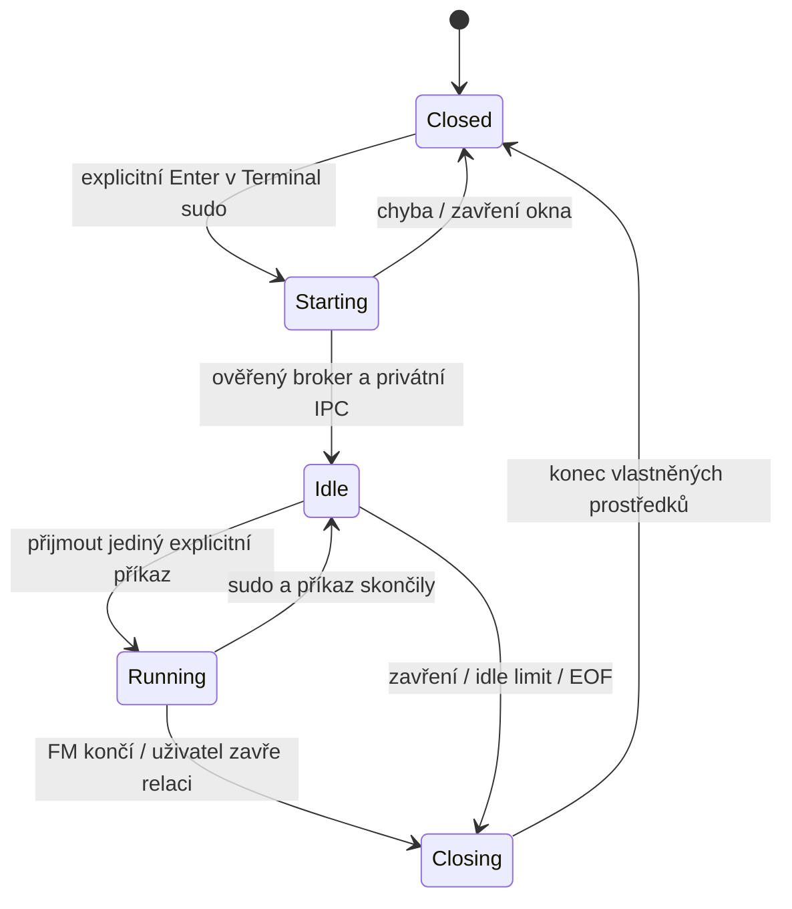

# Opakované použití terminálové relace a ověření sudo

Datum: 4. listopadu 2026. Stav: **návrh dalšího kroku, nikoli hotová implementace**.
Navazuje na [hlavní návrh](2026-11-04-dual-pane-file-manager-design.md) a
[commander ovládání](2026-11-04-commander-controls-design.md).

Uživatel chce zadat heslo při prvním použití sudo a další příkazy provádět bez
opakovaného dotazu, pokud je ověření stále platné. Souhlasil, že aplikace nebude
ukládat heslo ani měnit systémovou bezpečnostní politiku. Doporučení tohoto
dokumentu je znovu používat jeden **neprivilegovaný broker v jednom externím
terminálu**; každý explicitní příkaz spouští přes systémové sudo v téže relaci.

## 1. Co existuje a co zatím ne

Současný `TerminalService::launch_terminal` vrací pokaždé nový vlastněný
`Box<dyn TerminalProcess>` (Rust Child nebo nativní Windows process handle).
Linuxová implementace otevírá externí terminál a pro `Elevated` přidává
`/usr/bin/sudo --`. Její wrapper po příkazu provede `exec /bin/sh -i`; ve zvýšeném
režimu tím zůstává v tomto okně interaktivní root shell. Uživatel v něm může
pracovat ručně. **Další Enter v editoru FM však založí nové okno/TTY a do
předchozího okna se neposílá. Automatické opětovné použití ještě implementované
není.**

Konkrétní místa pro navazující změnu:

| Soubor / rozhraní | Dnešní chování |
| --- | --- |
| `fm-core/src/desktop.rs`: `TerminalRequest` | Zachycuje příkaz, raw cwd, shell a Standard/Elevated |
| `fm-core/src/desktop.rs`: `TerminalService` | Vrací nový TerminalProcess, neumí vrátit existující relaci |
| `fm-platform-linux/src/desktop.rs`: `COMMAND_WRAPPER`, `terminal_command` | Nový terminál a sudo pro každý požadavek; wrapper ponechá interaktivní shell |
| `fm-engine/src/desktop.rs`: `Desktop::launch`, `TrackedChild` | Jedna kapacita spuštění, osm sledovaných procesů, samostatný reaper |
| `fm-ui/src/presenter/desktop.rs`: `submit_command` | Zmrazí obsah editoru/cwd/shell/mode, hlídá duplicitu během spuštění |

Tato implementace nesmí být v UI nebo dokumentaci označená jako sdílená sudo
relace. Nový návrh při aktivaci reusable režimu nahradí root interaktivní wrapper
brokerem, který sám běží jako původní uživatel.

Referenční Salamander byl zkontrolován: `src/editwnd.cpp:316` získává COMSPEC,
`:409–412` sestavuje launch a `:477–482` vytváří nový proces s cestou aktivního
panelu. Toto Windows chování nedodává POSIX sudo/session kontrakt. Přebírá se
záměr zachytit aktivní cwd a explicitně spustit vstup; ANSI a pevné buffery
reference se do nového návrhu nepřenášejí.

## 2. Co skutečně poskytuje sudo

Sudoers spravuje vlastní dočasné záznamy ověření. Rozsah může být terminál,
rodičovský proces nebo globální uživatelský záznam; nový terminál proto nemusí
sdílet předchozí ověření. Přesnou dobu i požadavek na nové ověření určuje místní
politika, ne FM. Stejný broker/TTY zachovává identitu, ke které se záznam může
vázat. [Ubuntu 24.04: sudoers](https://manpages.ubuntu.com/manpages/noble/man5/sudoers.5.html)

`sudo -v` může ověření obnovit bez provedení příkazu; `-n` zakáže interaktivní
dotaz. `sudo -k` bez příkazu zneplatňuje příslušný záznam podle politiky, kdežto
`-K` maže všechny uživatelovy záznamy. FM nebude automaticky používat obnovovací
smyčku ani globální odstranění. [Ubuntu 24.04: sudo](https://manpages.ubuntu.com/manpages/noble/man8/sudo.8.html)

Z toho plyne omezený slib: během platnosti systémového ověření může další příkaz
v téže podporované relaci proběhnout bez hesla. Po vypršení, změně politiky nebo
jejím požadavku na ověření každého příkazu se systém znovu zeptá. FM tento
požadavek neobchází a nezobrazuje vlastní odhad „ověřeno do 12:30“.

## 3. Zvažované přístupy

| Přístup | Přínos | Náklad / rozhodnutí |
| --- | --- | --- |
| Heslo v paměti, keyringu nebo konfiguraci FM | Mohlo by se znovu dodat procesu | Odmítnuto; FM se nemá stát správcem sudo hesla, nepoužije `-S` ani askpass |
| Nové okno a periodické `sudo -v` někde na pozadí | Malá změna launcheru | Neřeší oddělené TTY a může bez práce prodlužovat oprávnění; odmítnuto |
| Trvale otevřený root shell / root IPC server | Příkazy už nepotřebují nové ověření | Obchází přirozené znovuověření pro další příkazy a zvětšuje privilegovanou část; nedoporučeno |
| Neprivilegovaný broker, stejná TTY, sudo na každý příkaz | Reuse systémové cache bez držení hesla či root serveru | Doporučený návrh; vyžaduje explicitní session API a ověřený lokální transport |

Nemění se `/etc/sudoers`, `timestamp_type`, `timestamp_timeout`, `NOPASSWD`,
PAM ani globální oprávnění. Nezavádí se automatické zvýšení pro běžný terminál.

## 4. Životní cyklus relace

Backend vlastní `TerminalSessionId`, generaci relace a stav. UI dostává pouze
krátká stavová data, nikdy file descriptors, socket, heslo nebo obsah TTY.



První Enter otevře jeden systémový terminál s brokerem a zachytí nejvýše jeden
počáteční příkaz. Broker v něm spustí sudo. Heslo či jiné ověření zadává uživatel
přímo systémovému sudo v tomto okně. Broker ani FM nečtou data terminálového
vstupu; stdin/stdout/stderr dítěte zůstávají připojené k terminálu.

Další Enter při `Idle` odešle do stejného brokeru nový explicitní příkaz. Při
`Starting` nebo `Running` se vrátí `Busy`; nové příkazy se nepřilepují do stdin
spuštěného programu, password promptu nebo editoru. Výchozí režim nemá frontu
příkazů čekajících na pozdější root provedení. Uživatel může mezitím používat
panely nebo otevřít obyčejný terminál.

Broker spouští přímo `/usr/bin/sudo -- /bin/sh -c <uživatelský zdroj>` s oddělenými
argv a zachyceným cwd. Jde o výslovně zadaný shellový program; do zdroje se
nepřidávají názvy souborů, IPC příkazy ani autentizační konstrukce. Každý sudo
proces je přímým dítětem téhož brokeru. Broker po skončení příkazu zůstává
neprivilegovaný; nespustí navazující root `sh -i`.

Cwd je schopnost lokálního filesystemu. Archiv, FTP nebo Registry umístění se
nepřevede na lokální cestu z jeho zobrazovaného textu. Bez výslovné schopnosti
providera dodat bezpečné lokální cwd terminálová akce vrátí Unsupported nebo
uživatel zvolí skutečný lokální adresář.

Relace může mít vlastní limit nečinnosti. Návrhový výchozí limit je pět minut,
nikoli údaj o platnosti sudo cache a nikoli uživatelem potvrzená hodnota. Idle
limit neběží jako důvod násilně přerušit aktivní příkaz. Nevytváří keepalive
volání `sudo -v`. Po novém spuštění aplikace je režim Standard a žádná stará
session ID ani spojení se neobnovují z nastavení.

## 5. IPC a důvěryhodná identita procesu

Socket s oprávněními 0600 nebo náhodný token sám nestačí k tvrzení, že příkaz
odeslala správná instance FM. Uživatel může mít jiné procesy se stejným UID;
otevřené ověřené TTY se nesmí stát obecně dostupným sudo command endpointem.

Linux adaptér použije privátní unixové IPC, kernelová peer credentials a přesnou
identitu původní instance FM. `SO_PEERCRED` poskytuje PID/UID/GID peeru;
credentials nejsou náhrada za kontrolu jeho životního cyklu.
[Linux man-pages: unix(7)](https://man7.org/linux/man-pages/man7/unix.7.html)

Procesní identita obsahuje UID, PID a kernelově ověřenou identitu životnosti.
Broker povolí pouze původní proces FM; nepřevezme nového klienta stejného UID.
PID se samostatně nepovažuje za identitu, protože může být znovu použit. Linux
adaptér má preferovat kernelově svázaný peer process handle; při použití pidfd
musí prokázat, že skutečně odkazuje na peer daného spojení. Pouhé pozdější
`pidfd_open(numeric_pid)` bez této vazby závod neřeší.
[Linux man-pages: pidfd_open(2)](https://man7.org/linux/man-pages/man2/pidfd_open.2.html)

Vzájemné ověření platí i opačně: FM ověří, že připojený broker patří právě
spuštěné terminálové relaci a očekávanému executable. Cizí proces nesmí vyhrát
závod o první spojení tím, že uvede stejné session ID.

### Bootstrap závisí na skutečném terminálu

Preferovaná cesta je předem vytvořený soukromý socketpair, pokud konkrétní
terminál umí ověřeně předat vybraný descriptor brokeru. Nelze předpokládat, že
libovolný emulátor zachová jiné descriptors než stdin/stdout/stderr.

Jinak je nutný krátce žijící rendezvous endpoint s atomicky vytvořeným soukromým
adresářem a přesným launch receipt. Pro emulátor, který skutečně drží spuštěné
dítě, lze ověřit brokerovu procesní identitu a vazbu na vlastněný launch proces.
Klient terminálového daemonu se nemusí stát jeho rodičem; samotné `--wait`,
název procesu, cesta k socketu nebo PID opsané z Hello zprávy nestačí.

První implementace proto podporuje reuse pouze pro adaptéry, u nichž test
prokáže bezpečné předání spojení nebo přesnou vazbu launch receipt ↔ broker.
Pokud Gnome Terminal či jiný daemon tuto vazbu neposkytne ověřeným API, reuse
vrátí `Unsupported`, přestože běžné otevření nového terminálu dál funguje.
Nesmí se potichu přepnout na neověřený endpoint nebo předstírat sdílené ověření.
To je nutný implementační spike před aktivací uživatelské funkce.

Po ověření zůstane jediné duplexní spojení a dočasný listener se uzavře.
IPC descriptors mají close-on-exec a nepřejdou do sudo ani do shellového
příkazu. Do procesu dítěte se neexportují session tokeny nebo interní adresy.
Broker odmítne spuštění jako root/setuid server; zvýšené je jen explicitní dítě.

### Protokol a meze

Použije se verzovaný binární rámec s číslem příkazu a délkami polí. Zprávy jsou
`Hello`, `Run`, `Accepted`, `Completed`, `Close` a `Closed`. Stav `Idle` se
odvozuje z tohoto privátního kanálu, nikdy z textu či escape sekvencí stdout.
Výstup příkazu ani falešný prompt proto nemohou vytvořit událost „připraveno“.

Příkaz je původní UTF-8 text. Cwd zůstává nativními cestovými daty providera
(na Linuxu i ne-UTF-8 bytes), nikoli textem z vykresleného řádku. Formát nemá
`MAX_PATH` buffer. Zprávy se čtou po částech s kontrolou délek, přetečení a
rozpočtu prostředků; alokační chyba se hlásí bez zkrácení či přesměrování cesty.
Krátká adresa unixového socketu je transportní adresa, ne limit identity cwd.

Stav drží nejvýše jednu spouštěnou relaci a jeden probíhající příkaz na relaci,
omezený počet relací a žádnou neomezenou frontu payloadů. Neznámé verze, neplatné
pořadí/ID, cizí peer, NUL v argumentu a nový `Run` mimo `Idle` se odmítnou.
Přijatý příkaz se nikdy automaticky znovu nespustí po ztrátě spojení; nelze pak
bez dalšího prokázat, zda už začal. UI zobrazí neurčitý výsledek místo retry.

## 6. Rozšíření existujících rozhraní

Samotný `Result<Box<dyn TerminalProcess>, FsError>` nevyjádří reuse bez nového procesu. Nepřidávat
falešného potomka typu `/usr/bin/true`, neklonovat Child ani znovu nereapovat
tentýž proces. Návrh je rozšířit terminálové služby o explicitní session schopnost
a rozlišit nový launch od submitu do existující relace:

```rust
// Návrhové typy; dosud nejsou součástí implementovaného API.
enum TerminalSubmission {
    NewProcess {
        process: Box<dyn TerminalProcess>,
        session: Option<TerminalSessionId>,
    },
    ExistingSession {
        session: TerminalSessionId,
        command: TerminalCommandId,
    },
}
```

Registry a stavový automat patří enginu. Platformní adaptér zajišťuje launch,
ověřený transport, procesní identitu a cleanup. `TerminalCapabilities` výslovně
rozliší běžný launch a `ReusableSudoSession`; nepodporovaný OS/terminál nevytváří
nefunkční stub. Windows PowerShell/cmd zatím mohou zůstat novým procesem;
macOS potřebuje vlastní soubory a ekvivalent peer/lifetime kontraktu.

Kapacita osmi procesů se rezervuje při vytvoření nové relace/procesu, nikoli
při každém reuse. Záznam vlastní jediný child/reaper slot, generaci, transport a
případnou aktivní command ID. Krátká operace submit nesmí držet globální launch
permit po celou dobu interaktivního sudo nebo spuštěného programu. Pomalá relace
nesmí blokovat otevření běžného terminálu nebo navigaci.

UI rozlišuje `Opening`, `Ready`, `Busy`, `Closing`, `Closed` a chybu. Neoznačuje
`Ready` jako záruku platné autentizace. Enter při zaměřeném editoru zachytí celý
draft, cwd, shell a mode právě jednou; změna pickeru nic neodešle a obsah
editoru neztratí. Zvýšený režim zůstává viditelný a má akci Close session.

Broker může být zvláštní CLI režim téhož `fm-app` executable, obsloužený před
inicializací Slintu a GUI runtime. Linux kód patří do Linux platformních souborů;
Windows/macOS těla nesmějí být v témže implementačním souboru. Samostatný helper
binary je alternativa pouze s vyřešeným balením a ověřením identity executable.

## 7. Ukončení, revokace a nejednoznačné výsledky

Zavření nečinné relace nebo IPC EOF broker ukončí. Při běžícím explicitním
příkazu označí relaci jako Closing a další příkazy odmítne. Výchozí chování je
dokončit již spuštěný příkaz a pak skončit; nezabíjet při zavření FM plošně
potomky podle nalezeného jména/PID. Zastavení aktivního programu je samostatná
výslovná akce nad ověřeným vlastněným procesem, ne automatický rollback.

Broker neběží jako root ani nenechává po skončení unmanaged root shell.
Příkaz, který uživatel sám výslovně zvolil jako interaktivní root shell, může
samozřejmě zůstat aktivní až do svého ukončení; FM do jeho stdin další Run
požadavky nepíše. Zamítnutí, zrušení autentizace či zavření okna nepřehraje
původní zdroj pod jinými oprávněními.

Close session uzavře vlastněné prostředky. Samostatná akce Forget authorization
může spustit `sudo -k` ve stejné TTY. Její dopad se řídí systémovou politikou:
při globálně sdíleném záznamu nelze slíbit izolaci od ostatních terminálů.
`sudo -K` se automaticky nepoužívá. Aplikace nečte ani nemaže timestamp soubory.

Nikdy se nepoužije postup „spusť `sudo -n <příkaz>`; při exit code 1 spusť znovu
interaktivně“. Původní příkaz se mohl provést a sám skončit jedničkou. Případný
stavový probe nesmí obsahovat uživatelský příkaz; k běžnému provedení probe není
potřeba. Všechny návraty po přerušení spojení rozlišují nepřijaté, přijaté a
neznámé dokončení.

## 8. Implementace po ověřitelných krocích

1. Doplnit core session ID/stavy/schopnosti a návrat nový proces/reuse. Zachovat
   standalone TerminalService chování a existující testy pickeru/Enter.
2. Udělat izolovaný Linux bootstrap spike nad jedním skutečným podporovaným
   terminálem: peer identity, lifetime, TTY stabilita, bezpečné předání spojení.
   Před jeho výsledkem nenabízet automatické reuse jako hotové.
3. Implementovat neprivilegovaný broker a parser/transport s fake executor.
   Prokázat, že žádný private FD nebo token nepřejde do dítěte a další Run mimo
   Idle se odmítá. V této fázi žádné skutečné sudo ani root testy.
4. Připojit engine registry, kapacitní slot/reaper, generace, Busy a Close session.
   UI dostává jen bezpečné stavy; načítání hesla a terminálový renderer nepřebírá.
5. Přidat běžné systémové sudo per command a ruční bezpečnostní ověření na
   dedikovaném testovacím stroji. Politika může stále vyžadovat každé ověření.
6. Teprve potom kvalifikovat další terminálové adaptéry a později macOS.

Před implementací je potřeba rozhodnout/ověřit konkrétní Linux transport a
podporovaný emulátor. To je technický feasibility krok, ne důvod ukládat heslo
nebo potichu snížit identitní kontrakt. Výše navržený idle limit je konfigurační
výchozí návrh, nikoli zásah do sudo cache timeoutu.

## 9. Přejímací testy

- Jeden broker/TTY a jeden stabilní rodič pro více explicitních příkazů;
  exekutor běží jako původní uživatel až do konkrétního sudo dítěte.
- První příkaz, další příkaz, vypršení politiky a odmítnutí politiky; žádný
  hardcoded předpoklad o délce cache. Automatické testy používají fake sudo
  executable s kontrolou argv/TTY, nikoli skutečné zvýšení oprávnění.
- Přesný Unicode draft a raw cwd, uvozovky, řídicí znaky, dlouhá cesta, chunkované
  rámce, krátké reads/writes, overflow a alokační chyby bez tichého zkrácení.
- Jiný UID, jiný proces stejného UID, podvržený endpoint, nepřítomný či recyklovaný
  peer PID, neplatný start receipt a proces zmizelý při bootstrapu se odmítnou.
- Busy při programu/authentication; stdout obsahující falešné Ready či escape
  sekvence nic neodemkne. Není žádná terminálová injekce do password promptu.
- Jedna rezervace procesu při otevření a žádná nová při reuse; plná kapacita a
  pomalá relace neblokují navigaci ani obyčejný nový terminál.
- Idle close, okno zavřené uživatelem, FM crash/EOF, aktivní příkaz při ukončení,
  ztracené potvrzení, reaper a opakované Close nemají duplicitní provedení.
- Nastavení/logy/crash diagnostika neobsahují heslo, session transport ani obsah
  terminálového vstupu. Zvýšený výběr se neobnoví po restartu.
- Nepodporovaný emulátor vrací Unsupported; běžný nový terminál zůstává použitelný
  a nesmí být vydáván za reuse již ověřené relace.

## 10. Kontrola proveditelnosti

Zvolený model umožňuje využít systémovou cache bez držení hesla a bez trvale
privilegovaného backendu. Zbývající skutečné technické riziko je důvěryhodný
bootstrap přes externí terminály, zejména daemonové emulátory. Tato část musí
být prokázaná testem a security review před zapnutím automatického směrování
dalšího Enter. Současná aplikace tento session manager zatím nemá.
