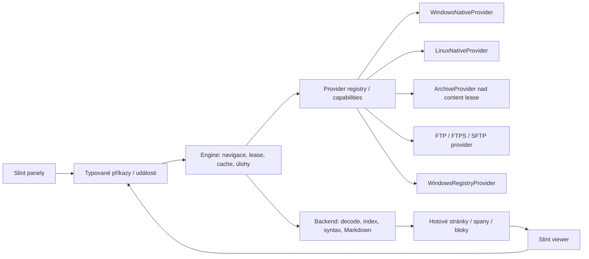

# Vestavěný prohlížeč a rozšiřitelné virtuální filesystémy

Datum: 4. listopadu 2026. Stav: návrh dalšího rozšíření, nikoli tvrzení o hotové
implementaci. Navazuje na [hlavní architekturu](2026-11-04-dual-pane-file-manager-design.md).
V této etapě se nemění produkční API ani se nezapíná dosud neimplementované F3.

Aktualizace 5. listopadu: [dynamické viewer/filesystem pluginy](2026-11-05-dynamic-viewer-filesystem-plugins-design.md)
finalizují balení, discovery, verzované C ABI, vlastnictví a nové pořadí etap.
Tento dokument zůstává podkladem pro obsahové kontrakty; v uvedených oblastech
má novější návrh přednost. Každý viewer/provider včetně nativního je odstranitelný
plugin. Pozdější [viewer rozšíření](2026-11-05-viewer-implementation-extension.md)
nahrazuje zde uvedené pořadí: tři samostatné text/binary, source a Markdown
viewery přijdou před migrací nativních a archivních filesystemů.

## 1. Zadání a rozhodnutí návrhu

Uživatel požaduje vestavěný prohlížeč pro prostý text, barevně zvýrazněný zdrojový
kód a vykreslený Markdown. Stejné panely mají později procházet lokální disky,
komprimované archivy, další vzdálené/virtuální filesystémy a Windows Registry.
Dosavadní zobrazení lokálních souborů se převede na prvního nativního providera;
každá platforma bude mít samostatnou nativní implementaci.

Trvají již potvrzené požadavky: Rust/Slint/Tokio, jeden proces s oddělenými crates,
všechna práce mimo vstup a prezentaci na backendu, Unicode bez ANSI převodů,
nezkrácené providerové identity, žádný aplikační MAX_PATH a omezené pracovní
kapacity. Budoucí kopie bajtových souborů musí nezávisle přečíst cíl a ověřit délku
a kryptografický hash. Registry ani archivy nesmějí tyto záruky předstírat.

Konkrétní interní datové typy, výchozí cache rozpočty a knihovny níže jsou doporučení
návrhu. Binární hranici nyní určuje samostatný verzovaný plugin kontrakt výše;
interní Rust traity ani futures nejsou plugin ABI.

Zvažované přístupy:

| Přístup | Výhoda | Náklad / rozhodnutí |
| --- | --- | --- |
| Přidávat archivy a Registry jako výjimky do dnešních panelů | Malá první změna | OS cesty a speciální větve by se rozšířily do UI, kopie i vieweru; odmítnuto |
| Jedno providerové rozhraní a čtecí content lease; text/Markdown render ve Slintu | Stejné panely i viewer, kontrola zdrojů a bezpečnosti | Doporučeno; migrovat po adaptérech, ne velkým přepisem |
| Všechno materializovat do TEMP a otevřít externí prohlížeč/WebView | Snadná integrace některých existujících viewerů | Další I/O, citlivé kopie a závislost na lokální cestě; jen pozdější explicitní adaptér |

## 2. Co bylo ověřeno ve zdrojích Salamanderu

Reference jsou v `D:\experiments\salamander-main`. Kód a prostředky s GPL licencí
se nekopírují. Převádí se záměr rozhraní, ne ABI, ANSI řetězce či pevné buffery.

| Zdroj a řádek | Ověřené chování | Dopad na tento návrh |
| --- | --- | --- |
| `src/viewer.h:170–181` | Prepare/LoadBefore/LoadBehind mohou znovu použít otevřený handle; komentář uvádí zpomalení síťového hledání opakovaným otevíráním | Viewer drží backendový čtecí lease, ne nový open pro každý řádek |
| `src/viewer2.cpp:286`, `:358`, `:409`, `:494`, `:562` | Stránkování okolí offsetu a doplňování čtecího bufferu | Zobrazovat hotové paměťové stránky; soubor se nenačítá z row_data/paint |
| `src/viewer.h:341`, `:370–372` | Auto/Text/Hex a znakové převodní tabulky | Zachovat volbu režimu/encoding; nahradit ji Unicode dekódováním a přesnými byte offsets |
| `src/plugins/shared/spl_view.h:33–72` | ViewFile/CanViewFile, životnost dočasné kopie navázaná na zavření vieweru | Probe nesmí mít vedlejší účinky; content lease a RAII lifetime místo HANDLE lock protokolu |
| `src/plugins/ieviewer/ieviewer.cpp:292`, `:474–475` | Markdown přípony a konverze Markdown → HTML před otevřením IE vieweru | Markdown je vlastní režim dokumentu; nespoléhat na příponu jako důkaz bezpečného obsahu |
| `src/plugins/ieviewer/markdown.cpp:14`, `:53–107` | cmark-gfm parser, tabulky/tasklist/strikethrough; komentář zmiňuje chybějící obrázky | Navrhnout AST/render a politiku zdrojů výslovně; nepřevzít Windows IE host |
| `src/plugins/shared/spl_fs.h:33–70` | FS může připravit kopii v diskové cache a spojit její životnost s viewerem | Paměťový/streamový lease první; omezená spool cache jen pokud je potřeba |
| `src/plugins/shared/spl_fs.h:208–242`, `:263` | Provider vlastní cestu/navigaci/výpis a deklaruje podporované služby | Provider vlastní parsování, rodiče, kořeny a capabilities; UI není parser lokálních cest |
| `src/plugins/shared/spl_arc.h:51`, `:81`, `:93`, `:105` | Výpis, čtení jednoho člena, přebalení a mazání jsou samostatné archivační operace | Procházení archivu je read-only provider; mutace mají samostatný transaction/publish kontrakt |
| `src/plugins/regedt/fs2.cpp:435–569` | Klíče jako adresáře, hodnoty jako položky; prázdné jméno představuje default value, W API | Registry potřebuje druh položky a surové typované hodnoty, nikoli jen File/Directory |
| `src/plugins/regedt/fs3.cpp:368–429` | Registry viewer exportuje hodnotu do cache/TEMP před OpenViewer | Nový viewer dostane typovaný či paměťový obsah přímo, bez povinného TEMP exportu |
| `src/plugins/regedt/regedt.h:347–354` | Registry FS zvlášť deklaruje View/Copy/Move/Watch a další služby | Schopnosti jsou vlastnosti provideru/uzlu, ne globální příslib všech operací |

V prozkoumaném built-in text vieweru není důkaz hotového obecného syntax
highlighteru. Barevné zvýraznění zdrojáků je nové explicitní rozšíření produktu.
Reference používá na více místech `char*`, MAX_PATH a řetězcové cache keys; tyto
reprezentace se nepřebírají a globální lowercase se nepoužije jako identita.

## 3. Hranice vrstev a migrační směr



`midnight-core` obsahuje pouze typy, chyby, kontrakty a zprávy. Provider registry,
orchestrace, lease registry, cache, rozpočty a copy engine patří `midnight-engine`.
VFS prezentace a viewer widgety patří `midnight-ui`; konkrétní provider se do UI
neimportuje. Nový plugin kontrakt vyžaduje samostatný Cargo projekt v jednom Git
repozitáři pro každou
konkrétní implementaci, vlastní testy a závislost pouze na veřejném API/SDK.
Pluginy nesmějí importovat interní app crates ani měnit zdrojáky hlavní aplikace.

- `WindowsFileSystem` se přes adaptér stane `WindowsNativeProvider` v dynamickém
  `midnight-fs-native-windows`. Win32, registry a Windows testy zůstanou v OS souborech.
- `LinuxFileSystem` se stane `LinuxNativeProvider` v dynamickém `midnight-fs-native-linux`.
- macOS později dodá `MacOsNativeProvider` ve vlastním crate a stejné conformance
  testy. Linux implementace se nepoužije jako skrytá macOS větev.
- `midnight-platform-common` smí sdílet skutečně přenositelné bezpečné Rust pomocné
  operace. `midnight-platform` je pouze malý selector/reexport podle targetu.

Hostitelské služby nastavení, terminálu, ikon a loaderu zůstávají odděleně
vestavěné; chybějící native plugin však nesmí mít statický fallback pro browsing.

První migrace zachová dnešní `FileSystem` jako interní kompatibilní adaptér.
Nativní služby nemusí být přepsané v jedné změně. Dočasný adaptér ale není cílové
univerzální API: dnešní `Entry.path: PathBuf`, FsError.path, `Path::parent`,
`starts_with` a výběr volume podle lokálního prefixu nejsou sémantikou archivu
nebo Registry.

Po migraci UI posílá ResolveLocation/Enter/Parent/OpenContent nad referencí, ne
`PathBuf::join` ani vlastní normalizovaný řetězec. Rodiče, breadcrumbs a návrat
z kořene připojeného archivu počítá provider/engine. Písmena disků zůstávají
metadata Windows lokací; společné UI kvůli nim neobsahuje Windows implementaci.

## 4. Identita, umístění a revize

| Typ | Význam a životnost |
| --- | --- |
| `ProviderId` | Stabilní identifikátor druhu implementace, například native.windows, archive.zip, registry.windows |
| `MountId` | Konkrétní připojení/instance: server a účet, otevřený archiv, registry view; ne heslo ani URL s credentials |
| `NodeRef` | MountId + providerem vlastněná opaque identita uzlu; UI ji pouze uchovává a vrací |
| `LocationRef` | Reference pro procházení uzlu s ListChildren; obsahuje potřebný mount/context |
| `EntryId` | Krátká identita řádku v konkrétním výpisu, jako dnes; není otevřená OS file identity |
| `VersionToken` | Volitelný providerový důkaz revize/validator, s uvedeným rozsahem záruky |
| `ContentLeaseId` | Backendem vlastněný otevřený byte stream či typovaný obsah; nesmí se použít po uzavření |
| `ViewerSessionId` / `ViewerGeneration` | Viewer a aktuální požadavek; staré stránky nesmějí přepsat novější zdroj/režim |

Opaque identita není automaticky bezpečný handle: engine ověří existenci mountu,
vlastnictví reference a capability. Operace revaliduje namespace a podle potřeby
pracuje s otevřenou identitou. Provider může po smazání položky vrátit StaleNode;
nesmí ji tiše změnit na novou položku se stejným zobrazovaným názvem.

Lokální provider interně zachová PathBuf/OsString. Archiv může používat ordinal
člena + generaci kontejneru a původní bytes jména. Registry reference obsahuje
hive, logický view, key identity, druh Key/Value a přesné UTF16 jméno hodnoty.
DisplayName/Breadcrumb/DisplayAddress jsou samostatné prezentační řetězce.

Žádná společná vrstva nezavádí počet znaků, komponent nebo MAX_PATH. Resource
budget může odmítnout náročný požadavek explicitní chybou; nesmí zkrátit identitu,
spojovat názvy podle display textu nebo měnit Unicode normalizaci. Case pravidla
a překlad uživatelské adresy patří provideru. Persistované adresy mají verzovaný
providerový encoding; credentials se ukládají odděleně podle autentizační politiky.

## 5. Provider API a capabilities

Základní kontrakt zůstane malý. Pro první provedení doporučuji dyn-compatible
metody s boxed `Send` futures a vlastněnými/bounded výsledky. Lokální adapter
uvnitř použije omezené blocking workery; síťový provider může skutečně awaitovat
I/O. Přímo `async fn` v traitu nelze bez ověření dyn compatibility zaměnit za
objektové API; pravidla určuje [Rust Reference](https://doc.rust-lang.org/reference/items/traits.html#dyn-compatibility).

Následující je kontraktový náčrt, nikoli kód k okamžitému vložení:

```rust
type ProviderFuture<'a, T> =
    Pin<Box<dyn Future<Output = Result<T, ProviderError>> + Send + 'a>>;

trait BrowseProvider: Send + Sync {
    fn resolve<'a>(&'a self, request: ResolveRequest) -> ProviderFuture<'a, ResolvedNode>;
    fn stat<'a>(&'a self, node: NodeRef) -> ProviderFuture<'a, NodeMetadata>;
    fn list<'a>(&'a self, request: ListRequest) -> ProviderFuture<'a, ListingBatch>;
    fn capabilities<'a>(&'a self, node: NodeRef) -> ProviderFuture<'a, NodeCapabilities>;
}

trait ContentReader: Send {
    fn read_next<'a>(&'a mut self, request: ReadRequest) -> ProviderFuture<'a, ByteChunk>;
    fn close<'a>(&'a mut self) -> ProviderFuture<'a, ()>;
}
```

ListRequest má request/generation/cancel/deadline/budget a opaque continuation.
ListingBatch má hotové položky, volitelný continuation a pravdivé Live/Snapshot
consistency. Provider neotevírá dialog a nevolá zpět UI; AuthenticationRequired
nebo Conflict se řeší typovanou engine událostí a novou odpovědí uživatele.

| Schopnost | Samostatný kontrakt |
| --- | --- |
| Browse / Resolve / Stat | Kořen, rodič, children, display crumbs, metadata a providerové řazení jmen |
| OpenByteContent | Read lease, známá/neznámá délka, revision a skutečná Sequential/ReadAt/Seek charakteristika |
| ReadTypedValue | Typ + původní data například Registry hodnoty; žádný předstíraný obyčejný soubor |
| Watch | Hints / rescan / polling možnosti; engine drží debounce a fallback |
| StorageProfile | LocalSsd/Rotational/Network/Unknown + odhad nákladů, ne úsudek podle krátkého benchmarku |
| PublishBytes | Výhradní staging, dokončení/sync, kontrolní čtení, no-replace nebo bezpečná výměna |
| ConditionalOverwrite | Podmíněné publikování proti potvrzené identitě/verzi cíle v linearizačním bodě; prostý stat+atomic rename nestačí |
| Namespace mutations | Mkdir/rename/remove/trash s přesnými alias/atomicity pravidly |
| Container mount | Otevření streamu jako dalšího filesystému a řízení jeho životnosti |
| Export / typed mutation | Explicitní kódování objektu do souboru nebo typově správná změna hodnoty |

Ne každá capability musí být metodou jedné obří třídy. Provider registry může
vracet oddělené service objekty; unsupported schopnost je None/Unsupported.
Capabilities platí na mount i konkrétní uzel a mohou se po odpojení, změně práv
nebo otevření šifrovaného archivu změnit. Mutation znovu ověří schopnost a revizi;
šedé tlačítko v UI není bezpečnostní kontrola samo o sobě.

NodeMetadata rozliší ByteFile, Directory, Symlink, ContainerCandidate,
RegistryKey, RegistryValue a případné providerové typy. Velikost běžných dat,
komprimovaná délka, počet hodnot a vypočtený součet mají odlišný význam.
Custom sloupce mají typované sort keys a hotový text/preview z backendu; jejich
vykreslení nesmí spustit dotaz. Native terminal cwd/host Properties je samostatná
capability, ne konverze display URI na Windows cestu. U virtuální lokace se
nepředstírá lokální pracovní adresář ani se potají nevytvoří TEMP cwd.

## 6. Archivy jako připojený filesystém

Enter nad rozpoznaným kontejnerem otevře MountId nad NodeRef původního souboru.
Přípona je nápověda; omezený backend probe ověří formát. Panel prochází adresáře
a členy stejným Browse API. Kořen archivu má explicitní parent anchor do
obsahující lokace a cursor hint na původní archiv. Zobrazení může být například
`D:\data\bundle.zip › docs`; tento řetězec se neposílá host OS.

Archiv se nemusí rozbalit celý na disk. Index i obsah mají vlastní lease a
zrušení. Čtení komprimovaného člena bývá sekvenční; random read je pouze tehdy,
když ho daná implementace skutečně nabízí. Viewer může použít omezený read-ahead
nebo explicitní spool cache. Nákladné opakované přehrávání dekomprese se nesmí
schovat za údajně levný read_at. Vnořený archiv používá opět content lease
předchozího provideru, tedy i archiv stažený ze serveru nebo uvnitř jiného archivu.

Bezpečnost a konzistence:

- Členy jsou identifikované ordinalem/revizí, ne pouze jménem. Duplicitní názvy a
  case/Unicode kolize se neztratí ani nesloučí. Resolve podle nejednoznačného jména
  vrátí Ambiguous; výběr konkrétního řádku si uchová jednoznačnou referenci.
- Absolutní cesty, drive prefixes, parent traversal, odkazy a konfliktní typy
  členů nesmějí uniknout do host namespace. Nebezpečný člen lze odmítnout nebo
  označit jako neexportovatelný a číst pouze přes jeho ID; listing není extrakce.
- Extrakce používá platformní bezpečný publish kontrakt a kontrolu otevřených
  rodičů/aliasů; join + strip_prefix nad řetězcem není ochrana proti symlink race.
- Vynucují se skutečně dekomprimované bytes, paměť, CPU/čas, počet otevřených
  kontejnerů a jejich agregovaný rozpočet. Nedůvěřovat deklarované velikosti ani
  samotnému compression ratio. Limit aktivního vnoření je resource politika,
  nikoli zkracování cest nebo obecný limit počtu komponent nativní cesty.
- Změna vnějšího archivu zneplatní jeho index/členy a potomky. Otevřený lease
  pravdivě oznámí stabilní starou verzi nebo ContentChanged; nesmíchá obě verze.
- Heslo šifrovaného archivu není v URI ani logu. Auth požadavek se oddělí od
  workeru; zrušení odstraní jen vlastněné cache/staging artefakty.

První archivní provider je read-only. Přepis archivu je pozdější transakce:
sestaví novou verzi ve stagingu, čtením znovu otevřeného člena ověří jeho délku
a kryptografický hash a bezpečně publikuje vnější kontejner. CRC archivu samo
nenahrazuje povinné ověření. Provider bez bezpečného přepublikování nepovolí zápis.

## 7. Registry je typovaný namespace

WindowsRegistryProvider bude samostatná Windows implementace s read-only prvním
rozsahem. Linux/macOS ji nepředstírají; pozdější offline registry-hive reader by
byl jiný provider nad souborem. Key a Value jsou různé druhy uzlů, i když mají
stejný viditelný název. Default value má prázdné surové jméno, ne identitu danou
lokalizovaným textem `(Default)`.

Provider uchová registry type code a původní data. REG_SZ/EXPAND_SZ/MULTI_SZ se
zobrazují z bezpečně ověřeného UTF16, čísla se správným typem/endianness, neznámé
typy jako raw bytes + type. Neúplné či vadné řetězce nejsou opraveny zápisem;
viewer je může bezpečně escapovat a nabídnout raw režim. EXPAND_SZ se při
prohlížení automaticky neexpanduje. Microsoft výslovně uvádí, že vrácené registry
řetězce nemusejí mít správné zakončení; respektuje se délka dat, ne hledání NUL
bez hranic. [Registry value types](https://learn.microsoft.com/en-us/windows/win32/sysinfo/registry-value-types)

Reference nese zvolený logický registry view, například Native/32/64; UI jej
nesestavuje přidáním Wow6432Node do cesty. Windows má oddělené logické pohledy
a fyzické redirection paths nejsou určeny pro přímé používání aplikací.
[Registry Redirector](https://learn.microsoft.com/en-us/windows/win32/winprog64/registry-redirector)

F3 otevře typovaný value document: druh hodnoty, délku, čitelnou interpretaci
a původní bytes. Export do souboru je výslovná operace s definovaným formátem.
F5 mezi registry namespaces by později muselo ověřit typ i raw hodnotu; není to
běžná bajtová kopie souboru. `Copy registry value` a `Export value` se nesmějí
zaměnit. První verze neprovádí zápisy, delete, expanzi environment variables,
automatické elevation ani spouštění nalezených command stringů.

## 8. Content lease jako společný vstup vieweru

Viewer nezná providerový handle, native File ani přihlašovací údaje. Engine
otevře content lease a vrátí ViewerOpened s identitou, metadaty, režimy a
deklarovaným přístupem k obsahu. Backendový handle drží otevřenou verzi nebo
pravdivě slabší live validator; runtime ViewerSession sdílí cache s dalšími
prohlížeči pouze při shodném zdroji, revizi a oprávnění.

ReadAt je volitelná schopnost. U sekvenčního streamu je dostupný rozsah jen to,
co už bylo načteno; seek vpřed je řízené čtení a zpět cache/replay/spool podle
deklarovaného plánu. Délka a počet řádků mohou zůstat neznámé. End nesmí čekat
na UI: nabídne backendové doindexování nebo přesun k dosud známému konci.

Spool/cache je backendem vlastněná, privátní, výhradně vytvořená, s kvótou,
revizí a RAII lease. Nemá odvozené nekontrolované jméno z člena archivu; nevejde-li
se obsah do rozpočtu, viewer oznámí omezení a zachová dostupný text. Neúspěšné
zrušení se nesmí projevit mazáním cizího souboru. Lease se zavírá a velké buffers
uvolňují na backendu. Reader nad mmap by neměl své stránky načítat až při UI
paint/page fault; tato implementační zkratka je pro UI zakázaná.

## 9. Tři režimy jednoho dokumentu

F3 doporučuji jako samostatné Slint okno se sdíleným tématem a hustotou aplikace.
Zpočátku je pouze read-only; editace a quick-view panel jsou pozdější funkce.
Dokument nabídne **Text / Source / Markdown** podle schopností a obsahu, Auto
vybere rozumný výchozí režim. Ruční přepnutí i encoding zachová session a byte
anchor; neotevře externí asociovanou aplikaci ani nespustí soubor.

### Prostý text

- Backend načítá byte stránky, detekuje BOM a validuje UTF8. UTF16 LE/BE a
  explicitně vybrané legacy encoding mají stateful decoder přes hranice bloků.
  Detekce bez BOM je návrh s uvedenou jistotou, ne tichá konverze přes ANSI codepage.
- Zdroj zůstává původní bytes. Decode chyby se zobrazí s byte pozicí a možností
  změnit encoding/raw náhled; zobrazený replacement znak se nikdy nestane identitou
  nebo podkladem pro tiché přepsání zdroje.
- Sparse index mapuje byte offsety, logické řádky a checkpointy dekodéru. Počet
  řádků se dopočítává na backendu. CRLF/CR/LF, UTF8 split, surrogate pairs,
  kombinace, emoji a RTL musí přežít hranice stránek.
- Zpočátku doporučuji no-wrap pro text/source. Obrovský řádek se segmentuje pro
  prezentaci a nesmí vyžadovat celé gigabajtové String ani UI layout všeho.
  Přesná Unicode shaping/wrap strategie extrémně velkého odstavce musí být
  ověřena; případný omezený režim se oznámí, ne skrytě rozbije text.
- UI dostává hotové viditelné řádky/spany a krátký overscan; posun jen vyžádá
  nové okno dat. Globální offsets jsou kontrolované u64, lokální UTF8 ranges jsou
  omezené velikostí stránky. Ani převod offsets nesmí zaměnit bytes a znaky.

### Barevný zdrojový kód

Highlight je další vrstva nad stejným decoded textem. Nesmí změnit bytes, výběr,
vyhledávání či kopírování. Jazyk se navrhne podle metadat/přípony a omezeného
probe, s ruční volbou. Gramatiky jsou přibalené/důvěryhodné; soubor vedle zdrojáku
nesmí automaticky přidat parser, plugin nebo spustitelný kód.

Pro readonly spike je kandidát syntect, protože nabízí line parsing a cacheable
stavy. Aktuální ParseState ale není Send/Sync a vyžaduje celý souvislý řádek.
Proto se parser/checkpointy drží na omezeném workeru s afinitou; mezi UI a Tokio
úlohami putují jen vlastněné decoded stránky a hotové spany. Dlouhé řádky mohou
dostat prostý text místo highlightu. [Syntect ParseState](https://docs.rs/syntect/latest/syntect/parsing/struct.ParseState.html)

Před definitivním výběrem se změří startup, zlé vstupy, dlouhé řádky a licence
přibalených gramatik. Parser/regex krok nemusí jít kooperativně přerušit; timeout
po návratu není tvrdá CPU izolace. Bounded syntax workery, limity vstupu a plain
fallback chrání UI; vyžaduje-li přejímka tvrdé ukončení, highlighter musí běžet
v pomocném procesu. Tree-sitter je případná alternativa pro další editorovou
etapu, nikoli důvod teď vytvářet AST všech obřích souborů.

Syntax cache je oddělená od barev: textové ranges a semantic token kinds nejsou
zapečené konkrétní RGB. Blue/Dark/Light změní mapu stylů bez opětovného čtení
souboru nebo ztráty pozice. Checkpoint před viewportem řeší otevřený víceřádkový
komentář/string; nezačíná se vždy na prvním viditelném řádku bez kontextu.

### Vykreslený Markdown

Doporučený první renderer je native Slint nad bezpečným block/span modelem, ne
browser s přístupem k host filesystemu. Kandidát pulldown-cmark dává event stream
a source ranges; stále provádí block parsing nad dokumentem, tedy není zárukou
konstantní paměti pro neomezený stream. [Parser a source maps](https://docs.rs/crate/pulldown-cmark/latest),
[architektura parseru](https://pulldown-cmark.github.io/pulldown-cmark/dev/index.html)

První sada: headings, odstavce, emphasis/strong, seznamy, blockquote, odkazy,
inline/fenced code a jednoduché tabulky/task lists. Fenced code použije stejný
highlighter. Zdrojové ranges umožní přepnout Rendered ↔ Source přibližně na
stejném místě. Tlačítko checkbox v preview nemění soubor. Podporovaná sada je
explicitní; nepodporovaný blok má čitelný fallback a Source je vždy dostupný.

Bezpečnost preview:

- Raw HTML se nesmí předat browseru nebo Slint rich textu jako aktivní markup;
  zobrazí se escapované či odmítnuté. JavaScript, formuláře, iframe, pluginy,
  CSS imports a automatické URI launch jsou vypnuté.
- Preview nic automaticky nestahuje ze sítě. Remote images/fonts/tracking odkazy
  zůstanou placeholderem. Přítomnost Markdownu uvnitř FTP není souhlas s dalšími
  síťovými požadavky ani s odesláním credentials jinému hostu.
- První bezpečná verze může mít všechny obrázky jako alt text. Pozdější lokální
  obrázky mají explicitně povolený resource scope, provider-relative resolve,
  revizi, decode/pixel budget a backendové dekódování. `../`, symlink nebo URI
  nesmějí obejít scope; textová prefix kontrola sama nestačí.
- Kliknutí na odkaz je záměr uživatele pro backend LinkPolicy. Anchor se řeší
  interně; lokální target jde přes provider a scope; http(s) může po explicitním
  uživatelském otevření použít desktop službu. command/javascript/data/UNC nebo
  jiné schéma se nespouští automaticky. Externímu cíli se neposílají mount secrets.
- Parsing, sanitizace, image decode, měření rozsáhlého dokumentu a úklid patří
  omezeným backendovým úlohám. UI vytváří pouze viditelné bloky a hotové obrázky.

Markdown reference definitions, seznamy či tabulky mohou ovlivnit vzdálenější
části dokumentu. Nezávislé parsování každých 256 KiB jako samostatného Markdownu
by bylo nesprávné. Plain/Source začne rychle; Rendered se připraví jako verzovaný
dokument v paměťovém/CPU rozpočtu. U velkých MD zůstane plain režim dostupný a
preview se může výslovně odmítnout nebo pracovat v oznámeném omezeném režimu.
WebView je až samostatné budoucí rozhodnutí se sandboxem, bez host bridge,
autorizovanými zdroji a vlastními platformními soubory; ne tichý fallback na IE.

## 10. Zprávy, rozpočty a interakce

Viewer příkazy: OpenViewer(node,mode), RequestViewport(session,generation,anchor),
SetEncoding/SetLanguage/SetMode, Find/CancelFind, CopySelection a CloseViewer.
Výsledky: ViewerOpened, ContentWindowReady, SyntaxSpansReady, MarkdownReady,
IndexProgress, ContentChanged, ResourceLimited a ViewerFailed. Stránka nese
session, generation, source revision a přesné ranges. Zastaralý payload se
předá k backendovému uvolnění, ne zničí v UI callbacku.

Požadavky viewportu jsou latest-state; poslední zastaralý seek nevytváří stovky
čekajících čtení. Open/close/errors a poslední terminální výsledek jsou spolehlivé.
Nativní čtení, dekomprese, syntax a Markdown mají nezávislé omezené kapacity;
viewer nevyčerpá rezervu pro navigaci ani kopírování. Síťový stream a HDD používají
konzervativní sdílený I/O rozpočet, SSD může read-ahead v omezené dávce. Spool na
lokálním SSD neznamená, že vzdálený zdroj získá síťový souběh4.

Výchozí návrh pro spike: byte chunk 256 KiB, text/syntax cache 16 MiB na viewer,
agregovaný paměťový limit 64 MiB; preview Markdown má samostatný parser/AST budget.
Čísla se ověří měřením a mohou se změnit. Jsou to limity současné práce/cache,
ne maximální délka cesty nebo důvod zkrátit obsah a prohlásit jej za celý soubor.

Find/Copy přes větší rozsah běží na backendu a mají průběh/rušení; UI neprojde
celý dokument. Textové hledání pracuje s dekódovaným textem, případně raw hledání
se zdrojovými bytes; jejich offsety se nezaměňují. Clipboard integrace patří
platformní službě, včetně jejího případného thread-affinity kontextu. Změnu zdroje
viewer oznámí a nabídne reload; stránky dvou revizí se nesmějí smíchat.

## 11. Vazba na ověřené kopírování

Byte-file kopie používá společný engine, nikoli zvláštní bezpečnostní pravidla
pro FTP či archiv. Potřebuje read lease zdroje, vlastněný staging cíle a schopnost
nezávisle číst přesně cílový obsah. Teprve shoda délky/hash po dokončení/sync,
deklarované zacházení se změnami zdroje a úspěšné publish dovolí Completed.
Serverový checksum nebo zip CRC může být pomocný údaj, ne automatická náhrada
nezávislého kryptografického ověření.

Provider bez bezpečného publish/readback kontraktu zůstane read-only nebo
vrátí Unsupported před mutací. Chybějící atomické přepsání neospravedlňuje
nejprve odstranit starý cíl. Export Registry má deklarovanou reprezentaci;
přenos typované hodnoty případně vyžaduje navíc ověření typu a dat. Copy/move/
delete stále sdílí tutéž operační frontu a její konfliktní identity/závislosti.

## 12. Pořadí implementace

Historické pořadí níže nahrazuje
[viewer rozšíření](2026-11-05-viewer-implementation-extension.md).
Původní pořadí a přejímku určuje
[nový plugin návrh](2026-11-05-dynamic-viewer-filesystem-plugins-design.md#10-migrace-a-implementační-pořadí):
ABI/SDK a dynamické testovací pluginy → oddělené loadery/balení → VFS identity
a nativní plugin každého OS → text/source viewer → ZIP, GZIP, TAR/TAR.GZ a 7z.
Teprve potom Markdown, Registry a síťové providery. Dynamické ABI je nově
požadavek prvního vieweru/VFS. Hot unload, editor, Registry write a archivní
repack se nezapnou jen proto, že panel umí číst jejich položky.

## 13. Přejímací testy

| Oblast | Nutné scénáře |
| --- | --- |
| Nativní adaptér každého OS | Dosavadní navigace/sort/výběr/watch/shell cwd; Unicode, dlouhé cesty, ne-UTF-8 Linux identity; žádná OS větev v obecném panelu |
| Falešné VFS | Jiný oddělovač a case pravidla, jména obsahující lokální speciální znaky, duplicitní display názvy, roots/parent, stale refs, částečná metadata a capability změny |
| Async chování | Blokovaný provider neblokuje UI/jiný panel; bounded fronty/paměť, poslední seek zvítězí, cancel během čtení/dekomprese/parse, žádný payload po zavření session |
| Text | Split UTF8/UTF16/BOM, čeština/CJK/RTL/emoji/combining, všechny newline typy, nulové bytes, vadný encoding, >4GiB offsets, obrovský řádek, zdroj změněný během pagingu |
| Syntax | Multiline kontext při skoku doprostřed, nesprávná přípona/ruční jazyk, velký/zlý řádek, parser error/timeout, plain fallback, theme změna bez I/O a stejné selection offsets |
| Markdown | Tabulky/lists/fences/reference links přes hranice, source map, raw HTML/JS/URI injection, remote tracking image bez requestu, resource escape přes symlink/archive, zlé obrázky a budget errors |
| Archivy | Duplicitní/casekolizní jména, invalid Unicode bytes, absolutní/parent traversal, link chains, zip bomb, podvržené délky, nested/archive-on-network, chybné/šifrované členy a zrušení spoolu |
| Registry | Default vs stejnojmenná key/value, všechny podporované raw typy a neznámý type code, vadné UTF16/MULTI_SZ, view32/view64, odepřený přístup, žádná automatická expanze či zápis |
| Kopie mezi providery | Readback corruption stejné délky, krátké čtení/zápis, změny zdroje/kontejneru, chybějící publish, konflikt názvů, zrušení a zachovaný původní cíl |

Zvlášť změřit čas do prvního viewportu a p95/p99 odezvy UI, ne jen throughput
dekodéru. Testy rendereru obsahují Blue/Dark/Light i Desktop/Touch a skutečné
scroll/selection hit testy. CI konfigurace ani headless test samy o sobě nejsou
důkazem vizuální kvality všech fontů nebo otestovaného macOS/Mint nasazení.

## 14. Drobné implementační volby ponechané další etapě

Formát interních opaque IDs, konkrétní highlighter,
počty workerů/cache budgety, wrap strategie a seznam prvních jazyků se stanoví
spikem a měřením před implementací dané etapy. Nemění to smlouvy: UI žádné I/O,
provider vlastní namespace, chybějící capability je pravdivě Unsupported,
Markdown nic samo nespouští a byte-file kopie nemá neověřený režim.
Registraci, plugin discovery a binární lifetime už stanoví novější plugin návrh.
