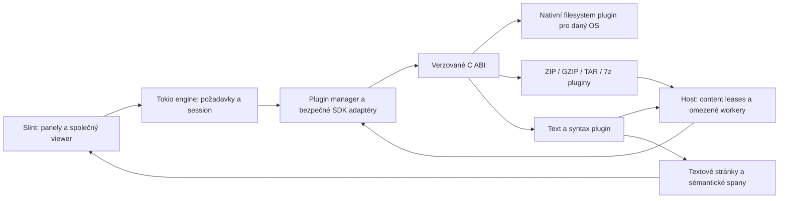

# Dynamické pluginy pro prohlížeče a souborové systémy

Datum návrhu: 5. listopadu 2026. Stav k 7. listopadu: loader, F3 pro text/binary,
source, Markdown, obrázky a PDF, procházení archivů a ověřené vykopírování jsou
implementované. Nativní Windows/Linux filesystémy dosud tvoří interní crates;
jejich převod na nezávislé pluginy ještě zbývá. Interní registr už zavádí typované
identity, odvolatelné čtecí lease a přechodové adaptéry native/archive; produkční
panely a zápisové operace se na něj dosud nepřevedly. Kontrakt a zbývající kroky
popisuje [provider registry](../../developer/PROVIDER_REGISTRY.md).
Aktuální rozsah a důkazy sleduje [implementační přehled](../../IMPLEMENTATION_BACKLOG.md).
Navazuje na [hlavní architekturu](2026-11-04-dual-pane-file-manager-design.md)
a [původní viewer/VFS návrh](2026-11-04-viewer-vfs-design.md).
Tento dokument má přednost pro registraci, binární hranici, balení a pořadí etap.
Původní pravidla Unicode, identit, bezpečného čtení, Markdownu a ověřování kopií platí dál.

## 1. Rozsah a rozhodnutí

Požadavek uživatele: každý konkrétní viewer a filesystem bude samostatně
dynamicky načitatelný plugin vedle aplikace. Přítomný kompatibilní plugin přidá
funkci, chybějící ji odebere. První viewer zobrazí prostý text a syntax známých
zdrojových jazyků. Filesystémy zahrnou nativní platformu, ZIP, GZIP, TAR.GZ a 7z.
Dodatečný požadavek: pluginy se vyvíjejí samostatně a sdílejí pouze veřejné API;
jejich testy jsou součástí pluginu. Plugin ani jeho build/test nesmí upravovat
zdrojové kódy hlavní aplikace.

Zůstává jedna aplikace s oddělenými Rust crates, Slint UI a Tokio backendem.
Archivní plugin podporuje procházení a čtení, včetně otevření člena ve vieweru
a vykopírování přes společný ověřený copy/publish engine. Změny archivů a další
providerové mutace zůstávají samostatnou etapou; instalace pluginu je nezapne.
Markdown preview a externí editor již fungují; Registry a obecné síťové providery
zůstávají dalšími implementacemi.
Budoucí [Network filesystem](2026-11-05-network-filesystem-design.md) nabídne
objevená i ručně zadaná lokální síťová zařízení/služby. Jeho nepřítomnost odebere
discovery; známé síťové cesty mohou dál obsloužit nativní providery. Metadata
aktuální síťové lokace řídí Network label/ikonu v drive dropdownu, zatímco
breadcrumbs zachovají celou skutečnou cestu. Discovery se v aktuální UI etapě
neimplementuje.

| Varianta | Rozhodnutí a důvod |
| --- | --- |
| Rust `dylib` se sdílenými traity a Tokio/Slint typy | Odmítnuto: Rust ABI nemá záruku stability; plugin by závisel na interních detailech konkrétního buildu |
| Rust `cdylib`, malé verzované C ABI, bezpečný Rust SDK adaptér | Zvolený návrh: samostatné balíčky, jedna aplikace, žádné UI v knihovně a jasné vlastnictví |
| Plugin v pomocném procesu s IPC | Implementováno pro archivy, obrazové/PDF a thumbnail dekodéry přes samostatné veřejné protokoly a omezené workery; hlavní UI/backend zůstává jednou aplikací |

Volba C ABI, rozložení balíčku a read-only pořadí jsou realizační rozhodnutí
tohoto návrhu. Požadavek na pluginy sám o sobě neznamená hot reload, podporu
libovolného binárního jazyka ani bezpečné spouštění nedůvěryhodných DLL.
[Rust ABI](https://doc.rust-lang.org/reference/items/external-blocks.html#abi)
a [`cdylib`](https://doc.rust-lang.org/reference/linkage.html) určují základ;
kompatibilitu dat a protokolu musí zajistit naše vlastní specifikace.

## 2. Hranice komponent a odpovědnost



UI nevolá ani nenačítá plugin. Vstupem pluginu není Slint window, UI callback,
`PathBuf`, Tokio runtime, Rust trait object ani ukazatel do UI modelu.
Plugin nemá vlastní GUI/event loop. Hostitel sdílí jediný renderer textu,
výběr, okna, focus, klávesy, témata, tooltipy a přístupnost. Plugin vrací data.
Tím se do každého pluginu negeneruje další kopie Slint komponent.

| Budoucí crate / vrstva | Odpovědnost |
| --- | --- |
| `midnight-core` | Bezpečné interní typy VFS, vieweru, capabilities a chyb; žádné FFI |
| `midnight-plugin-api` | C layout, číselné tagy, verze, specifikace zpráv a generovaný C header; bez Slintu/Tokia |
| `midnight-plugin-sdk` | Veřejná součást API distribuce: úzké auditované FFI wrappery, vlastnictví bufferů, dispatch, bezpečné Rust rozhraní pro autory pluginů; žádná interní implementace hostitele |
| `midnight-plugin-host` | Discovery, validace, ABI adaptér, knihovní lifetime; platformní loadery v oddělených souborech/crates |
| `midnight-engine` | Tokio orchestrace, registry, mount/session/lease, rušení, rozpočty, cache, budoucí copy engine |
| `midnight-viewer-text` | `cdylib`: dekódování, index, hledání a volitelné syntax spany |
| `midnight-fs-native-windows`, `midnight-fs-native-linux` | Samostatné `cdylib` implementace společného VFS; později `midnight-fs-native-macos` |
| `midnight-fs-zip`, `midnight-fs-gzip`, `midnight-fs-tar`, `midnight-fs-7z` | Nezávislé archivační `cdylib` projekty; vlastní implementace, závislosti a testy |
| `midnight-fs-network` | Budoucí samostatný discovery/filesystem plugin; vlastní projekt/testy, API-only závislosti a oddělené OS adaptery |
| `midnight-platform-*` | Vestavěné hostitelské služby: start aplikace, nastavení, loader, terminál, clipboard, ikony a fonty |

Obecné platformní služby nejsou další skrytá implementace VFS. Host musí umět
načíst konfiguraci a pluginy i bez nativního VFS. Procházení uživatelských souborů
potom poskytuje výhradně nativní plugin. Platformní implementace a testy se
nadále nemíchají v jednom souboru; sdílený SDK kód je platformně neutrální.
Nové auditované FFI výjimky zůstanou ve vyhrazených crates; core/engine/app bez unsafe.

### Samostatný vývoj a vlastnictví testů

Podle volby uživatele z 6. listopadu 2026 zůstává jeden Git repozitář. Každý
dodávaný plugin je samostatný Cargo projekt/workspace pod `plugins/`, s vlastní
release verzí, `Cargo.lock`, závislostmi, buildem a CI. Názvy crates v tabulce
neznamenají, že pluginy patří mezi workspace members hlavní aplikace. To platí
i pro nativní Windows/Linux/macOS filesystemy a první text viewer; nejsou výjimkou.
Sdílený Git neznamená sdílený Cargo workspace ani závislost na interních app crates.

Jedinou sdílenou projektovou závislostí je vydaný veřejný API balíček: ABI/schema,
header, čistý SDK adaptér a případný obecný conformance harness. SDK je součást
veřejného kontraktu, nikoli způsob importu `midnight-core`, `midnight-engine`, `midnight-ui`,
`midnight-platform-*` či `midnight-plugin-host`. Ani transitivně nesmí plugin záviset na
interních crates aplikace, jiném pluginu, privátních helper knihovnách projektu
nebo zdrojových souborech hostitele. Běžné nezávislé knihovny třetích stran jsou
povolené; dva pluginy mohou použít stejný veřejný decoder crate bez sdílení své
implementace. API nepřibaluje konkrétní parser, renderer nebo native provider.

Plugin musí jít sestavit a otestovat z exportu jeho vlastní složky pouze s vydaným
API/SDK a svými deklarovanými závislostmi. Není potřeba checkout hlavní aplikace.
Zakázané jsou cesty do jejího workspace, `include!` jejích zdrojů, lokální patche
jejích crates, build-script generování do jejích adresářů i úpravy aplikace kvůli
konkrétnímu pluginu. Instalace přidává jen vlastní package do `viewers/` nebo
`filesystems/`; nemění EXE, zdrojáky hostitele ani ostatní balíčky.

Unit, integration, parser/format fixtures, fuzzing, benchmarks a platformní testy
konkrétního pluginu žijí v jeho projektu a běží v jeho samostatném CI jobu. Obecnou conformance
sadu veřejného API spouští také plugin CI. Test s reálným hostitelem použije
vydanou binárku/test harness a vlastní dočasnou instalační sestavu; nesmí vyžadovat
editaci host source tree ani instalovaných uživatelských pluginů. CI pluginu
nemá zápisový přístup do zdrojů hlavní aplikace: používá export pluginu a vydané
API/SDK, případně hlavní zdroje připojené pouze pro čtení. Monorepo tento zákaz neruší.

Hostitel vlastní jen svoje obecné loader/broker/UI testy a integrační testy přes
veřejnou hranici, například absence pluginu, ABI mismatch a fake blocked provider.
Neudržuje kopie testů ZIP parseru nebo text highlighteru. Plugin release předává
artefakty, manifest, licence a výsledky vlastních testů; aplikace/distribuční CI
je pouze sestaví do balení a ověří kompatibilitu/integraci.

Chybějící API schopnost znamená návrh samostatné verzované změny API/hostitele,
provedený jeho maintainerem. Plugin zůstane na podporovaném API nebo oznámí
Unsupported; nesmí si hostitele automaticky patchnout. Počáteční migrace dnešního
native backendu je hostitelem řízená samostatná změna aplikace, ne oprávnění
pluginu měnit ji při vývoji, sestavení, testu, instalaci či běhu. Toto pravidlo
vývoje a CI nemění skutečnost, že nativní kód bez OS sandboxu má práva procesu
popsaná v oddílu 9.

## 3. Balení, discovery a chybějící funkce

Příklad Windows distribuce; Linux mění knihovny na `.so`, později macOS na `.dylib`:

```text
Midnight Explorer/
  me.exe
  viewers/
    text/
      plugin.toml
      midnight_viewer_text.dll
  filesystems/
    native-windows/
      plugin.toml
      midnight_fs_native_windows.dll
    zip/
      plugin.toml
      midnight_fs_zip.dll
    gzip/
      plugin.toml
      midnight_fs_gzip.dll
    tar/
      plugin.toml
      midnight_fs_tar.dll
    sevenzip/
      plugin.toml
      midnight_fs_7z.dll
```

Základ je skutečná instalační lokace spustitelného souboru, nikdy current working
directory, adresář aktivního panelu, PATH ani archiv. Plugin package je jeden
přímý podadresář jednoho z těchto dvou kořenů, s manifestem a jednou entry library.
Nevyhledávají se rekurzivně náhodné DLL/SO. macOS později mapuje stejná dvě
logická umístění na podepsaný app bundle; nevyžaduje zápis vedle běžící aplikace.

Manifest má `schema_version`, stabilní `id` (např. `midnight.viewer.text`), `kind`
(`viewer` nebo `filesystem`), `version`, `entry_library`, `target`, `abi_major`,
`minimum_host_minor`, seznam `required_host_services`, podporované modely/formáty
a popis. `entry_library` je jediné jméno souboru v package, nikoli libovolná cesta.
Verze produktu 0.1 a verze pluginu jsou nezávislé na ABI 1.0. Příklad:

```toml
schema_version = 1
id = "midnight.viewer.text"
kind = "viewer"
version = "0.1.0"
entry_library = "midnight_viewer_text.dll"
target = "x86_64-pc-windows-msvc"
abi_major = 1
minimum_host_minor = 0
required_host_services = ["content.read.v1", "work.schedule.v1"]
models = ["text-page.v1"]
```

Backend při startu přečte omezené manifesty bez načtení jejich kódu. Ověří
schema, target/architekturu, cestu, deklarované API a duplicity. Dvě balení se
stejným ID se obě odmítnou; pořadí adresářů nevybere vítěze. Volitelné unknown
pole je možné přeskočit, neznámá povinná služba nebo major ABI znamená odmítnutí.
Manifest je popis, ne důkaz pravosti. Skutečný descriptor se po načtení musí shodovat.
Každý balíček implementuje právě jednu rodinu rozhraní, může deklarovat více
formátů/režimů. Nejsou povolené přímé runtime závislosti na jiném pluginu;
kompozici zajišťuje host přes leases, nikoli načítání sousedních pluginů z pluginu.

Discovery proběhne automaticky při spuštění. Kód se načítá líně na backendu
při prvním potřebném probe/open; start nepotřebuje nahrát všechny gramatiky
a kodeky. Options zobrazí seznam pluginů se stavem Available/Loaded/Disabled/
Incompatible/Failed a stručnou příčinou. Uživatel může plugin vypnout; instalace,
odstranění a změna zapnutí se uplatní při příštím startu. V první verzi se
neprovádí hot unload ani nahrazení knihovny za běhu. Neexistující adresáře jsou
platná prázdná sada, poškozený balíček neukončí discovery ostatních.

| Odebraný balíček | Chování při příštím spuštění |
| --- | --- |
| Text viewer | F3 text/source není dostupné; host neobsahuje skrytou kopii parseru a automaticky nespouští externí viewer |
| ZIP / GZIP / TAR / 7z | Příslušné interní procházení není dostupné; soubor zůstává viditelný u jeho providera |
| Nativní filesystem daného OS | Okno/Options fungují, lokální disky a cesty nejsou dostupné; panel ukáže chybějící provider |
| Provider pro uloženou kartu/záložku | Zachovat adresu i jméno, označit nedostupné; nevymazat nastavení ani přesměrovat jinam |

Chyba otevření archivu (poškození, šifra, limit, chybějící codec) není důvod
automaticky spustit soubor hostitelskou asociací. Pro běžnou asociaci zůstane
oddělená explicitní akce. Pokud plugin chybí, nabídka interního otevření zmizí;
uživatel dostane vysvětlení při vyvolání již uložené virtuální lokace.

## 4. Binární kontrakt ABI 1

Každá knihovna exportuje jediný entry point `midnight_plugin_entry_v1`, přes `extern "C"`.
Vrací status a vyplní hostitelem předaný descriptor `PluginApiV1`. Hlavička
obsahuje `struct_size`, `abi_major`, `abi_minor`, `kind` a tabulku funkcí.
Nejde o export běžného Rust traitu. C header a přesný wire-schema katalog se
stanou verzovanou součástí `midnight-plugin-api` před první implementací pluginu.

| Funkce společné tabulky | Kontrakt |
| --- | --- |
| `create(host_api, config, out_instance)` | Vytvoří backendovou instanci bez I/O; neotevírá okno ani soubory |
| `submit(instance, request)` | Přijme vlastněnou kopii omezeného požadavku nebo vrátí QueueFull/Unsupported; rychlá operace |
| `cancel(instance, request_id)` | Idempotentní signál; dokončení rušení se oznámí událostí |
| `drain(instance, capacity, out_events)` | Odebere hotové bounded výsledky, nikdy nečeká na I/O |
| `release_buffer(instance, buffer_id)` | Uvolní pouze buffer alokovaný touto instancí; provádí backend |
| `begin_shutdown(instance)` | Zastaví příjem nové práce, ruší otevřené session a požadavky |
| `destroy(instance)` | Smí nastat až po Quiescent, bez requestů, workerů, callbacks a vypůjčených bufferů |

Host API má `schedule_work`, `cancelled`, `submit_service`, `notify_ready`
a omezenou redigovanou diagnostiku. `submit_service` asynchronně žádá content
read/seek/close, přidělení cache nebo autentizační odpověď; výsledek přijde jako
typovaná ServiceReply přes dispatch. Plugin nevolá VFS jiného pluginu přímo.
Viewer služby nepotřebují obecné open-by-path ani síťová oprávnění.

Pravidla, která SDK musí vynutit a conformance test ověřit:

- Pouze `repr(C)` struktury, explicitně široká čísla, celočíselné tagy/stavy,
  opaque handles a pointer+length. Přes hranici nejdou `String`, `Vec`, `Box`,
  `Result`, `dyn Trait`, Rust enum, `Future`, `Waker` ani Tokio/Slint objekt.
- Řídicí payload je verzované CBOR se stabilními číselnými field/message tags,
  definite lengths a rozpočtem hloubky/objemu; ne odvozená Rust memory layout
  ani implicitně verzovaný bincode. Raw obsah souboru se neposílá jako CBOR pole
  jednotlivých bajtů, ale samostatný bounded buffer s buffer ID.
- Vstupní borrowed slice platí jen po dobu volání; asynchronní příjemce kopíruje
  potřebná data nebo si přes host buffer službu výslovně ponechá lease.
  Výstupní buffer zůstává platný do `release_buffer`; host ho nikdy neuvolňuje
  vlastním allocatorem. Sdílené immutable host buffers mají retain/release přes
  host API. Žádný Rust allocator, refcount ani destructor se neodhadují přes ABI.
- Descriptor má prefix kompatibilitu: major musí souhlasit, minor smí přidat
  volitelný konec struktury/tag/capability. Host nečte za `struct_size`; povinné
  ukazatele musejí být přítomné. Neznámý volitelný event lze přeskočit a uvolnit,
  neznámý required kontrakt odmítne handshake. Target, bitness a platformní C ABI
  musejí odpovídat; shodný compiler není podmínkou.
- `RequestId`, `SessionId`, `MountId`, `LeaseId` jsou hostem přidělené generační
  identifikátory se scope plugin instance. Cizí/uvolněný ID se odmítne.
  Providerové opaque identity jsou délkově určené bytes, nikoli dereferencovatelné pointers.
- Host serializuje entry calls jedné instance na backend dispatch kontextu;
  work callbacks smějí běžet souběžně jen podle udělených permitů. `notify_ready`
  z workeru jen probudí hosta, nikdy synchronně nereenteruje plugin ani UI.
  `drain` nesmí čekat na mutex držený přes I/O nebo dlouhý parserový krok.
- `schedule_work` přijímá opaque job context a C run/drop callbacks. Host drží
  vlastníka knihovny i jobu, spustí ho na povoleném backend workeru a zavolá
  pluginový drop právě jednou. Rejected enqueue ponechá vlastnictví volajícímu.
  Workery mají CPU/I/O třídu a volitelnou afinitu; thread-affine parser se vytváří,
  používá a ničí na stejném dedikovaném workeru.
- Plugin nesmí propustit panic/exception přes ABI. SDK zachytí unwind tam, kde
  je podporovaný; chybový status neznamená zotavení po UB, abortu nebo poruše
  paměti. Všechny callbacks včetně run/drop mají stejný no-unwind kontrakt.

Hostitelské safe Rust rozhraní může vracet boxed `Send` futures/streams, které
adaptér dokončuje ze zpráv. Tento interní pohodlný API tvar není binární ABI.
Tokio runtime zůstává v hostiteli. První pluginy používají host workery a content
služby, nevytvářejí neomezené vlastní threadpooly. Budoucí síťový plugin může mít
vlastní reactor za touto hranicí, jen s explicitním budget/shutdown kontraktem.

## 5. Asynchronní průběh, rušení a životnost

Každý přijatý request nese owner, generation, source revision, deadline a budget.
Vrátí nula či více výsledků/progress a právě jeden terminální Completed/Cancelled/
Failed. QueueFull znamená nepřijetí, takže po něm terminální výsledek nepřijde.
Rušení není Completed. Po Cancel může doběhnout stale chunk; host ho zahodí
a uvolní na backendu. UI znovu ověřuje viewer/panel generation a revision.

Fronty mají limity počtu i bytes, rezervu pro cancel/close/terminal a signalizaci
obnovené kapacity. Producent přestane číst/dekomprimovat, když nemůže předat data;
nepřesune backlog do neomezeného Vec. Pro čekající výsledky nesmí držet I/O permit.
Draining probíhá férově po dávkách; viewport je latest-wins, metadata/progress lze
slučovat. Průběh nejvýše čtyřikrát za sekundu; hotový viewport a terminální chyby
nemusí čekat na tento interval. UI nekopíruje ani neuvolňuje obří plugin payload.

Při vnořeném čtení nesmí worker blokovat na vlastním host service requestu.
Uloží continuation, vrátí permit a pokračuje po reply. Tím archive→archive→native
nevyčerpá pool navzájem čekajícími workery. Pořadí permitů a rozpočty host určuje
globálně podle skutečného zdrojového úložiště, ne počtu pluginů.

Modul zůstává načtený do ukončení procesu; session/instance se mohou bezpečně
zavírat dříve. Close ruší práci a uvolňuje leases v závislostním pořadí. Dokud
běží callback/OS operace, nesmí zaniknout instance, její buffer ani host API.
Nezrušitelné blokující volání může držet worker déle; deadline zruší požadavek
uživatele, nikoli fyzicky thread. Host označí plugin nedostupný pro novou práci
a ponechá jeho ownership až do skutečného konce nebo ukončení procesu.
Neprovádí se násilné ukončení threadu ani unload pod běžícím kódem.

## 6. Filesystem API

Základem je `ProviderId` (druh), `MountId` (instance) a `NodeRef` (mount + opaque
identity + generation). UI má jen krátký hostitelský handle. Nativní provider
uchovává raw UTF-16/Unix bytes, archiv ordinal člena a generaci kontejneru.
Display text, quick-search case folding a Unicode normalizace nikdy neurčují identitu.
Neexistuje aplikační MAX_PATH ani pevný buffer pro cestu; rozpočtové odmítnutí
náročných dat je explicitní a nezkracuje adresu.

| Služba / požadavek | Povinný výsledek a význam |
| --- | --- |
| `Describe`, `ListRoots` | Provider descriptor, navigovatelné kořeny; kapacita/label se mohou doplnit asynchronně |
| `ProbeContainer` | Bounded nezapisující rozpoznání nad content lease; confidence, potřebný access a podporované metody |
| `Mount`, `Unmount` | Root, mount capabilities a lifecycle; archive dostane backing lease a explicitní parent anchor |
| `ResolveLocation`, `ResolveChild`, `Parent`, `DescribeLocation` | Provider vlastní namespace, case pravidla, breadcrumbs a verzovanou persistent address |
| `ListChildren` | Dávky položek, continuation a ListingRevision; částečný výsledek není konečný prázdný adresář |
| `Stat`, `GetCapabilities` | Typovaná metadata s Known/Unknown/Unavailable a schopnosti konkrétního uzlu |
| `OpenRead`, `ReadNext`, volitelně `ReadAt`/`Seek`, `CloseRead` | Content lease, délka/revize/konzistence a skutečné náklady přístupu |
| `Watch`, `Unwatch` | Dávkové hints a overflow→rescan, případně pravdivé Unsupported/polling |
| `StorageProfile`, `SpaceInfo` | Zdrojový I/O cost/concurrency group; volná kapacita jen kde má význam |
| Volitelné `GetNativeLocation`, `ReadTypedValue` | Explicitní bridge pro host Shell/cwd nebo budoucí Registry hodnoty; ne display string jako OS path |
| Budoucí mutation/publish služby | Samostatně vyjednané create/stage/verify/publish/rename/remove kontrakty |

`ListRoots` je povinné pro nativní provider, `ProbeContainer/Mount(backing)` pro
archivní provider; unsupported role není nucena předstírat druhou. Jediný globální
booleovský `writable` nestačí. Schopnosti mají scope instance/uzel/lease a kontrolují
se znovu při operaci; read-only V1 mutační capability neinzeruje.

Metadata zachovají dnešní kind, link/junction, skutečnou FS compression, logickou
velikost, timestamps s přesností a dostupností, ikony a raw identitu. Komprimovaná
velikost člena archivu je jiné pole než nativní příznak FS compression. Neznámá
velikost, datum či místo se nezobrazuje jako nula nebo epoch. Výpis má oddělený
stable row ID a identity uzlu. Continuation nelze přenést do jiné revize/listingu.
Live výpis neslibuje snapshot; provider oznámí, kdy je nutný rescan.

Read lease deklaruje `Sequential`, `ReadAt` nebo `SeekWithReplay` a cenu čtení.
`StableSnapshot` smí tvrdit jen při skutečné záruce; obyčejný otevřený native handle
sám nezabrání změnám obsahu. Slabší `LiveValidated` používá revision checks a při
zjištěné změně vrátí ContentChanged. Offsety/počty jsou kontrolované `u64`, délka
je volitelná, short read není automaticky EOF. Lease má explicitní EOF/integrity stav.

### Delegování obsahu a nezávislé čtecí pozice

Content broker odděluje vlastníka zdroje od jeho čtenářů. Interní SourceLease
drží providerový open/mount a revision. Každý příjemce dostane nový scoped
ReaderLeaseId, jehož owner je konkrétní plugin instance/session. Číselný handle
native pluginu se nikdy nepředává jako platný handle jiné instanci. Jen host
smí delegovat read-only právo na tentýž SourceLease a drží reference všech závislostí.

Každý ReaderLease má samostatný kurzor: ReadNext jednoho vieweru nebo probe
nespotřebuje vstup druhého. ReadAt kurzor nemění. Close zruší pouze tohoto čtenáře;
poslední reader/owner zavře backing open. Close provideru/mountu nesmí odstranit
obsah stále vlastněný viewerem; explicitní revoke nebo zjištěná změna oznámí chybu
všem dotčeným čtenářům, nikoli výměnu zdroje pod stejným ID.

Probe dostává samostatný omezený reader nebo immutable vzorek s byte offsetem;
zbytek rozpoznávání i následný Open začínají na vlastních souřadnicích. U skutečně
seekable zdroje broker multiplexuje read_at, případně serializuje seek+read pod
providerovým lockem. Sekvenční zdroj potřebuje sdílené bounded buffering/spool
nebo explicitně naplánovaný replay. Zpětný reader mimo dostupné okno může dostat
NeedReplay/ResourceLimited, nesmí tiše posunout ostatní čtenáře či blokovat UI.

Nové otevření/replay musí respektovat původní source revision a deklarovanou
konzistenci. Pokud provider neumí obnovit stejnou verzi, broker vrátí
ContentChanged/Unsupported a vyžádá nový Open; nesmí znovu otevřít stejnou cestu
a tvrdit, že dostal stejný snapshot. Leases pro sekvenční archivní členy jsou
nezávislé logicky, nikoli příslib nezávislé levné fyzické dekomprese.

Budoucí kopie čte zdroj a počítá BLAKE3, poté nezávisle znovu čte dokončený cíl
a porovná délku/hash před bezpečným publish. Zdrojový snapshot nebo pravdivý
kontrakt detekce změn je nutný; timestamp/velikost samy nedokazují neměnnost.
CRC archivu je kontrola formátu, ne náhrada ověření kopie. Move nesmí smazat zdroj
před ověřeným cílem. Provider bez potřebných publish/readback schopností mutaci odmítne.

## 7. ZIP, GZIP, TAR a 7z

| Plugin | První funkční rozsah | Přístup a zásadní odlišnost |
| --- | --- | --- |
| ZIP | Strom členů, ZIP64, uložené/Deflate členy, metadata, čtení a CRC kontrola na EOF | Centrální index obvykle potřebuje seek; komprimovaný člen bývá sekvenční |
| GZIP | Virtuální root s jedním logickým souborem; standardní concatenated gzip members tvoří spojený stream | Není adresářový archiv; skutečná rozbalená délka může být neznámá |
| TAR | `.tar`, `.tar.gz`, `.tgz`; běžné ustar, PAX a GNU long-name záznamy; strom a čtení běžných souborů | Index vzniká průchodem, gzip přidává dekompresi/replay; velikost listing/index cache je omezená |
| 7z | Strom, běžné Copy/LZMA/LZMA2 a BCJ varianty, solid i non-solid čtení | Solid blok sdílí dekompresní stav/náklady více členů; nejde o nezávislé levné seeks |

Tabulka je přejímací základ, ne slib všech metod historicky přidaných do formátu.
Každá implementace vystaví `supported_methods` a `encryption_support`.
Šifrovaný ZIP/7z, další filtry, sparse TAR a multi-volume sady mají explicitní
capabilities a fixture testy; první minimum je nešifrované single-volume čtení.
Nepodporovaná metoda/šifra vrátí konkrétní Unsupported, nikdy falešný prázdný
soubor nebo poškozený dekódovaný obsah. Rozhraní již obsahuje AuthenticationRequired
pro pozdější šifrované archivy; čekající otázka nedrží worker.

TAR plugin obsahuje vlastní soukromý gzip decoder helper, proto `.tar.gz`
nezávisí na přítomnosti samostatného GZIP pluginu. Jeho odebrání odebere pouze
samostatné gzip procházení. Pro `.tar.gz` se po omezeném ověření gzip+tar vybere TAR
před generickým GZIP. U nejasného výsledku host použije uloženou explicitní volbu
uživatele, jinak nabídne kandidáty; nerozhodne náhodným pořadím souborů.
Přípona sama není důkaz; probe má budget a může vrátit NeedMore/Unknown.
Chybějící TAR lze stále procházet jako jedno gzip data payload, pokud GZIP existuje.

GZIP FNAME je jen nedůvěryhodná nápověda display jména; nikdy cílová OS cesta.
ISIZE je modulo 2^32, nikoli důvěryhodná celková velikost. Čtení ověřuje každý
member trailer; useknutí, CRC chyba a nepovolený trailing garbage se hlásí.
7z může mít komprimovanou hlavičku, velký dictionary a solid blok. Tyto náklady
patří už do mount/probe budgetu. Čtená část člena není označena za plně integrity
ověřenou před dosažením příslušné kontroly. [GZIP specifikace](https://www.rfc-editor.org/rfc/rfc1952.html),
[7z vlastnosti](https://www.7-zip.org/7z.html).

7z plugin zná členství v solid bloku a vlastní jeho sdílený decoder, checkpointy
a deduplikaci čtenářů, klíčované backing revision + block ID. Hostitel neparsuje
7z struktury. Plugin hlásí opaque concurrency group/cost a rezervuje cache/work
přes host služby; host vynucuje společné limity i rozpočet původního úložiště.
Zrušení jednoho čtenáře neukončí decode potřebný jiným; poslední zájemce jej ruší.
Výchozí souběh dekomprese jednoho solid streamu je jedna úloha; rychlé SSD není
důvod několikrát přehrávat stejný blok. Jednotlivé ZIP členy mohou využít omezené
paralelní workery podle backing storage/CPU/paměti. Síť/HDD zůstávají konzervativní.

Archivy se při otevření celé neextrahují. Index lze dávkovat/spoolovat do
hostem spravované cache; TAR nemusí mít celý strom okamžitě. `ReadAt` na
sekvenčním podkladu se nepředstírá: host může nabídnout explicitní cancellable
spool/replay, s limitem skutečných bytes a oznámeným nedostatkem místa.
Soukromá cache má náhodné vlastní názvy, soukromá oprávnění, žádné cesty ze členů,
žádná hesla v metadatech a cleanup po session/startu; bezpečné přepsání disku se neslibuje.

### Namespace, bezpečnost a změny

- Všechny členy, včetně duplicit, mají samostatný ordinal + container generation.
  Jména podle ZIP flags/Unicode extra fields, TAR PAX nebo 7z se dekódují podle
  formátu. Raw bytes zůstávají zachované; legacy encoding lze explicitně přepnout.
  Unicode/case kolize nevedou ke sloučení. Prefixové hledání panelu je dál vždy
  Unicode case-insensitive; tím se nemění lookup/identity pravidla provideru.
- Absolutní členy, `..`, drive/UNC prefixes, ADS a separator konflikty nejsou
  OS cesty. Nebezpečný člen lze zobrazit odděleně podle ID jako neexportovatelný,
  nelze jej použít pro escape mimo virtuální root. Links/hardlinks se zobrazují
  jako metadata; první etapa je automaticky nenásleduje a nevytváří na hostiteli.
  Device nodes/FIFO/socket nikdy neotevírají obsah při listingu ani F3.
- Budoucí extrakce musí mapovat každý člen přes bezpečný cílový provider,
  kontrolovat kolize/reserved names/odkazy a publikovat ověřená data. Textový
  `join`/`starts_with` nechrání před symlink race ani Windows namespace aliasy.
- Počítají se skutečně dekomprimované bytes, dictionary, index, počet členů,
  CPU práce, cache, aktivní leases i vnoření; deklarované rozměry nejsou alokační
  pokyn. Agregovaný budget nelze obejít vnořeným archivem nebo druhým panelem.
- Mount drží backing lease; závislosti tvoří acyklický graf. Parent v kořeni
  vede do původního panelového umístění s cursor hintem na archiv. Zavření panelu
  nezruší lease stále používaný viewerem; mount končí až po posledním owneru.
- Watch backing souboru invaliduje index a potomky. Host zachová skutečně stabilní
  starou verzi nebo oznámí ContentChanged; nemíchá nové offsets se starým indexem.
  Když source nemá Watch, engine používá revalidation/polling podle capability,
  ne falešný nativní watcher uvnitř archivu. Platí stávající debounce visible panelů.

## 8. Viewer API a první textový plugin

F3 vybírá dostupný viewer podle nastavení pro příponu a podporovaných capabilities;
omezený probe může ověřit vhodnost. Alt+F3 toto směrování obchází a žádá roli
`basic-text` s `mode=Text`: bez zvýraznění zdrojového kódu a bez renderování Markdownu.
Roli oznamuje `Describe`; host si může pamatovat výslovně zvoleného poskytovatele
této role. Prostý „ASCII“ režim stále podporuje Unicode, volbu kódování a viditelné
náhrady vadných bajtů. Neexistuje-li basic-text plugin, akce hlásí nedostupnost;
nespustí jiný viewer ani externí program. F3 i Alt+F3 zůstávají do implementace
pluginu návrhem. Reference Salamander: `src/salamand.rc:70–71`.

`ViewerProvider` podporuje `Describe`, `Probe`, `Open`, `RequestViewport`,
`SetMode`, `SetEncoding`, `SetLanguage`, `Find`, `CancelFind`, `ReadSelection`
a `Close`. Odpovědi jsou `Opened`, `TextPage`, `SyntaxSpans`, `IndexProgress`,
`FindMatch`, `SelectionChunk`, `ContentChanged`, `ResourceLimited` a terminální
výsledky. Společný request/event kontrakt z oddílu 5 platí i pro ně.

Probe má metadata a omezený vzorek přes host content službu; nesmí provést plné
čtení ani vedlejší efekt. Výsledek obsahuje confidence, podporované režimy,
`text-page.v1` model a případný požadavek na seek/spool. Uživatelská volba vieweru
má přednost před automatickým skóre. Unknown file type může dostat plain text;
binární data se nezamaskují za zdroják. Ruční text režim je možný s viditelnými
náhradami vadných/control bytes, bez interpretace ANSI escapes nebo obsahu.

`Open` dostane hostem omezený `ContentLeaseId`, display metadata, revision,
mode=Auto/Text/Source, encoding preference a budget. Plugin nikdy nepotřebuje
cestu k TEMP souboru ani přímý nativní file handle. F3 v archive memberu a na
nativním souboru používá stejný viewer. Pokud zvolený viewer chybí, jiný skutečně
načtený kompatibilní viewer lze nabídnout; neexistuje skrytý vestavěný fallback.
Plain fallback při selhání syntaxe je součástí přítomného text pluginu.

### Stránky a souřadnice

`TextPageV1` nese session/generation/source revision, byte anchor, decoded UTF-8,
řádky/segmenty, source map, newline metadata a Known/Unknown stav rozsahu/indexu.
Source offset je kontrolované `u64` v původních bytes; decoded range je index
UTF-8 bytes uvnitř omezené stránky. Výběr a hledání používají source anchor plus
decoder revision; nesmějí zaměnit byte offset, Unicode scalar, grapheme a pixel.
Source map rozliší BOM, CRLF, chybné sekvence i rozdílné délky UTF-16/UTF-8.

`SyntaxSpanV1` je validovaný UTF-8 range + sémantický style ID, např. Keyword,
String, Comment, Number, Type, Function, Operator. Nejde o HTML, Slint markup,
RGB zapečené do souboru ani nový text. Spany se překrývají jen podle definované
priority modelu; SDK je normalizuje na konečné ordered runs v rámci stránky.
Neznámý styl má plain fallback. Theme změna přemapuje styly bez nového I/O.

Host renderuje jednu společně tvarovanou řádku/odstavec se styly, ne samostatný
Slint Text pro každý token. Jinak by se rozbil RTL/arabský shaping, ligatury
a hit testing výběru. První implementační spike musí prokázat zvýraznění,
selection, clipboard mapping, Unicode a bounded virtualizaci na skutečném
rendereru Slintu; současný projekt tento viewer renderer zatím nemá.
Pokud stock widget nestačí, vytvoří se jeden sdílený hostitelský renderer,
nikoli kopie widgetů v každém pluginu.

### Text, zvýraznění a odezva

- První viewport má přednost před indexováním celého souboru. Sparse index,
  dekódování, hledání, syntax, čtení výběru i velký cleanup běží na backendu.
  Viewport latest-wins, malý overscan; žádné I/O/page faults v paint callbacku.
- UTF-8 a UTF-16 LE/BE s BOM, UTF-8 bez BOM, explicitní volba encoding a
  diagnostika chybných sekvencí. Legacy encoding je volba uživatele, ne ANSI
  identita. Rozhraní umožní další dekodéry. CRLF/CR/LF a EOF bez newline,
  kombinace/emoji/CJK/RTL musejí fungovat přes hranice chunků.
- Počáteční no-wrap režim má horizontální scroll. Obrovské řádky se segmentují
  v oznámeném omezeném režimu; nevytváří se gigabajtový String/layout. Přesnost
  shaping/bidi přes extrémní segmentované odstavce je součástí renderer přejímky,
  nepředstírá se neomezený kontext s konstantní pamětí.
- Syntax určí filename/extension, shebang a omezený content probe; uživatel může
  jazyk změnit. Vydání přibalí verzovaný katalog gramatik s licencemi a příklady.
  Cílový základ: Rust, C/C++, C#, Java, Go, Python, JavaScript/TypeScript, shell,
  PowerShell, HTML/CSS, JSON, YAML, TOML, XML, SQL a Markdown source. Konkrétní
  podporovaný seznam publikuje plugin; neznámý jazyk dostane čitelný plain text.
  „Zdrojový kód“ není slib gramatiky pro každý existující/proprietární jazyk.
- Highlighter je vyměnitelná interní knihovna text pluginu. Kandidát syntect
  potřebuje checkpointy víceřádkového kontextu; jeho zdokumentovaný ParseState
  5.3.0 není Send/Sync a `parse_line` zpracovává celý řádek. Proto worker affinity,
  omezené vstupy a plain fallback; žádné nepravdivé `unsafe impl Send`.
  Výběr/připnutí knihovny následuje až po renderer/performance a licenčním spike.
  [Syntect ParseState](https://docs.rs/syntect/5.3.0/syntect/parsing/struct.ParseState.html).
- Parser nikdy nenahrává gramatiku, konfiguraci s kódem nebo plugin z adresáře
  prohlíženého souboru. Neprovádí LSP/build/script, nevytváří síťové požadavky.
  Překročený syntax budget ponechá plain text a přesné source ranges; parserový
  timeout není tvrdé přerušení nativního regex kroku.
- Find a velký ReadSelection jsou cancellable streams. Selection text se dekóduje
  na backendu podle stejného encoding; clipboard integruje host platformní služba.
  Není-li celý výběr v rozpočtu, operace oznámí limit a nezkopíruje nepozorovaně
  jen prefix. End na sekvenčním streamu neblokuje UI a nevymýšlí konečný počet řádků.

Počáteční měřené rozpočty: 256 KiB content chunk, 16 MiB text/syntax cache na
viewer, 64 MiB agregovaná viewer cache. Archivní index, dictionary a disk spool
mají samostatně sledované limity se společným celkovým stropem. Přesná čísla
doladí benchmark; nejsou maximální velikostí souboru ani cest. Stránky i spany
mají limit bytes a počtu položek, aby milion tokenů nezatížil UI v jednom eventu.

Pozdější Markdown plugin použije nově vyjednaný `document-blocks.v1` model se
source map; V1 text model mu nepodsouvá HTML. Zachová se zakázané automatické
stahování, aktivní HTML/script a hostitelská LinkPolicy. Absence Markdown pluginu
ponechá `.md` jako text/source, pokud text plugin existuje. Editorové mutace jsou
samostatné budoucí capabilities, nikoli změna významu ReadSelection.

## 9. Bezpečnost načítání a realistické záruky

Interaktivní HTML používá samostatný procesový protokol, nikoli textový či
Markdown ABI. Volitelný Chromium plugin, jeho offline výchozí režim, zachycené
prostředky a platformní dohled popisuje
[návrh HTML vieweru](2026-11-09-html-viewer-design.md). Oprávnění tohoto režimu
nemění inertní chování Markdown vieweru.

Nativní plugin je důvěryhodný spustitelný kód se stejnými OS právy jako aplikace.
C ABI, Rust wrapper ani seznam capabilities nejsou sandbox. Vadný/malicious
plugin může obejít host služby, shodit aplikaci, uváznout nebo poškodit paměť.
Stejně tak parser běžící v procesu nemá garantované tvrdé CPU/memory ukončení.
Tento model je slučitelný s dříve zvolenou jednou aplikací; tvrdá izolace by
vyžadovala novou procesovou/sandbox hranici, kterou kontrakt zpráv umožní doplnit.

Instalace balíčku do plugin root je výslovné udělení důvěry k jeho spuštění.
Oficiální balení dodává kontrolované knihovny, licence a integrity metadata;
prostý hash uložený vedle DLL není důkaz důvěryhodného vydavatele. Bezpečnost
discovery stojí i na vlastnictví/oprávněních instalační lokace. Portable instalace
v uživatelském adresáři je podporovaná; sdílené adresáře zapisovatelné cizími
nedůvěryhodnými účty nejsou bezpečný plugin root a loader je odmítne.

- Manifest se parsuje bez spuštění knihovny, s velikostním a strukturálním
  rozpočtem; symlinks/reparse escapes a relativní traversal do jiného balíčku
  se odmítnou. TOCTOU mezi kontrolou a load se řeší platformním balením/otevřenou
  identitou, kde to OS dovoluje; kontrola řetězce cesty není záruka proti útočníkovi
  s právem měnit stejnou instalaci. Instalační root je důvěryhodná hranice.
- Windows loader používá plnou Unicode cestu a explicitní
  `LOAD_LIBRARY_SEARCH_DLL_LOAD_DIR | LOAD_LIBRARY_SEARCH_SYSTEM32`, nikdy
  rozšíření search path o panel/cwd. Soukromé závislosti patří do package a mají
  unikátní názvy; OS loader může sdílet již načtené moduly, nejde o izolaci namespace.
  [LoadLibraryExW](https://learn.microsoft.com/en-us/windows/win32/api/libloaderapi/nf-libloaderapi-loadlibraryexw).
- Linux loader používá absolutní cestu a `RTLD_NOW | RTLD_LOCAL`; build kontroluje
  DT_NEEDED/RUNPATH a povolí jen očekávané systémové nebo soukromé závislosti.
  Samotná absolutní cesta hlavního SO nezaručuje bezpečné hledání jeho závislostí.
  Prostředí procesu nastavené útočníkem/LD_PRELOAD není touto politikou sandboxované.
- Kód v DllMain/ELF constructors může běžet ještě před ABI handshake. Manifest
  kontrola proto nečiní neznámou knihovnu bezpečnou. Entry/constructors nesmějí
  dělat dlouhé I/O; nespouštějí se na UI ani Tokio executor threadu.
- Hesla budoucích archivů jsou krátkodobé session secrets mimo logy, URI,
  persistent addresses a manifests. Jejich cache je explicitní host policy;
  plugin je nesmí sám trvale ukládat. Přenos obsahu ani probe nesmějí automaticky
  spustit Shell, externí archivační utility či stahovat kodeky.

## 10. Migrace a implementační pořadí

1. Verzovat `midnight-plugin-api`, header a SDK ownership/queue protokol; vytvořit
   fake viewer a fake filesystem jako skutečné sdílené knihovny. Nejdřív testovat
   ABI kompatibilitu, dynamické načtení, nepřítomnost a rušení přes reálnou hranici.
2. Přidat oddělené Windows/Linux loadery, manifest discovery, plugin status
   v Options a release/dev balení do `viewers`/`filesystems`. Aplikace se sestavuje
   nezávisle; každý plugin má vlastní build helper/CI. Samostatný packaging krok
   převezme konkrétní verzované plugin artefakty a zkopíruje je do distribučního
   stromu, bez patchování/buildování jejich zdrojů v app workspace. DLL/SO a staging
   zůstanou v ignorovaném `target`/build stromu. Samotný Cargo build aplikace
   není po migraci kompletní distribuce.
3. Přidat provider registry, generační reference a safe adaptéry. Dnešní
   `FileSystem`/Directory/Volume/Storage/Watch přesunout za nativní pluginy pro
   každý OS. Path mapy v engine nahradit mount-aware identity; nezhoršit existující
   search, multiselekci, sort, sizing, watch, ikony, disky, karty a bookmarky.
   Staré native persistent cesty migrovat bezeztrátově, bez cizích providerů.
4. Přidat shared content broker a text viewer/renderer spike; potom skutečné
   F3 prostý text, Unicode, hledání, selection, velké soubory a syntax v jednom
   text pluginu. Oddělit renderer/index/highlighter a používat společné funkce.
5. ZIP plugin a archive mount navigace; potom GZIP, TAR/TAR.GZ a 7z jako samostatné
   balíčky. Prokázat member→F3, sekvenční obsah, source změny, nesting, limity
   a skutečné odebrání každého pluginu na Windows i Linuxu.
6. Následně bezpečný Markdown plugin, případně šifry/další metody, Registry,
   síťové providery a macOS se stejnými conformance testy. Ověřená kopie a mutace
   mají vlastní bezpečnostní etapu; nezapnou se automaticky v tomto kroku.

Během přechodu může existovat interní native adapter pro malé postupné změny.
Konečná distribuce ale nesmí udržovat statickou fallback implementaci téhož
VFS/vieweru: test odebraného pluginu je podmínkou dokončení migrace.

## 11. Přejímací testy a měření

| Oblast | Povinné scénáře |
| --- | --- |
| Nezávislý vývoj | Export jedné plugin složky z monorepa se sestaví a otestuje pouze s veřejným API/SDK, bez app sources; žádné přímé/transitivní interní nebo cross-plugin dependencies; vlastní CI/fixtures/fuzzing; build/test/install nemění host sources ani EXE; integrace přes vydanou binárku v temp sestavě |
| Discovery / skutečná DLL/SO | Prázdné složky; přidání/odebrání každého pluginu a restart; jiný cwd; Unicode/dlouhá instalační cesta; duplicate ID; wrong bitness/target; chybějící dependency; poškozený manifest; mismatch descriptor; symlink/reparse escape |
| ABI | Samostatně kompilované host/plugin fixtures; minimum/minor prefix a nekompatibilní major; unknown required vs optional; short struct; allocator ownership; queue Full vs accepted; malformed message/span/length; stale/cross-instance handles |
| Lifetime / async | Pozdní callback po cancel, instance shutdown s leases/workery/buffery, exactly-once terminal/drop, notification race, backpressure, nesting při jediném worker permitu bez deadlocku, thread affinity, backend cleanup |
| Content broker | Dva viewery s nezávislými ReadNext, nepoškozující probe→Open, delegated scope/revocation, close jednoho čtenáře při aktivním druhém, replay stejné revize nebo explicitní chyba, zrušení jednoho zájemce o společný solid decode |
| Nativní migrace | Dosavadní Windows/Linux suite, lossless Unix bytes/UTF-16, dlouhé cesty, case-sensitive native složka, inotify/Windows watcher, stale ID, disky/cwd/icons a nepřítomný native plugin |
| ZIP | ZIP64, store/deflate, CRC až na EOF, broken central directory, unsupported/encrypted method, data descriptors, duplicate/case/Unicode jména, traversal a forged sizes |
| GZIP/TAR | Více gzip members, chybný trailer/ISIZE, >4 GiB stream, gzip FNAME traversal, PAX/GNU long names, partial listing, hardlink/symlink/special entries, TAR.GZ funguje i bez GZIP pluginu |
| 7z | Copy/LZMA/LZMA2/BCJ fixtures, solid/non-solid, compressed header, dictionary limit, decoder corruption, unsupported/encrypted/multi-volume odpověď, dvě čtení téhož solid bloku bez dvojí plné dekomprese |
| Archivní integrace | Native→ZIP→text F3; archive→archive; source změna/removal při index/read; watch debounce; sequential spool cancel/full disk; zavřený panel s otevřeným viewerem; žádné tiché extrahování/launch |
| Viewer | UTF8/UTF16 split/BOM, CRLF/CR/LF, invalid bytes, čeština/CJK/arabština/RTL/emoji/combining; >4 GiB offsets, obří řádka, partial encoding sequence, source změna a stale výsledky |
| Syntax / renderer | Každá deklarovaná gramatika, multiline checkpoint a seek, unknown/plain fallback, hostile/long line, stejné selection/source bytes před/po highlightu, všechny themes a hustoty, jeden shaped paragraph, změna tématu bez I/O |
| Bezpečnost / fuzzing | Manifest/CBOR/spans/parser/decompression fixtures; checked arithmetic, celkové rozpočty, žádný shell/network při probe/view, neexportovatelné nebezpečné členy, kontrola soukromé cache |
| Budoucí copy conformance | Nezávislé cílové readback poškození stejné délky, source revision, overwrite conflict, safe publish a cancel bez ztráty původního cíle |

Záměrně havarující native ABI fixtures běží v testovacím subprocessu; test suite
nesmí očekávat zotavení hostitele z UB v témže procesu. Fake blocked provider
musí ponechat UI, druhý panel a jiné pluginy použitelné v dostupných rozpočtech.
Benchmarks vykážou cold startup s/bez pluginů, čas do prvního viewportu, UI
p95/p99 latenci, peak RSS/cache, zbytečné bytes dekomprese, velikost celé distribuce
a generovaného UI. Nehodnotit jen zmenšení EXE přesunutím týchž bytes do DLL.

## 12. Reference Salamanderu a hranice přejímky

Znovu porovnáno se zdroji `D:\experiments\salamander-main`; žádný GPL kód ani
prostředky se nekopírují:

- `src/plugins/shared/spl_view.h:38–65`: oddělený CanViewFile/ViewFile a lifetime
  otevřeného obsahu. Nový kontrakt používá probe + lease, ne lokální cestu/TEMP lock.
- `src/viewer.h:170–181`, `src/viewer2.cpp`: znovupoužití otevřeného handle
  a bufferování okolí viewportu; nový viewer neotevírá soubor pro každý řádek.
- `src/plugins/shared/spl_fs.h:208–263`: provider vlastní navigaci a deklaruje
  služby; tady capability/query messages a opaque identity bez MAX_PATH.
- `src/plugins/shared/spl_arc.h:51–105`: listing, čtení člena a archivní mutace
  jsou odlišné operace; read-only mount není neověřený write/extract engine.

Tato změna dokončuje design, neimplementuje runtime pluginy ani neoznačuje
dosavadní F3 za funkční. Konkrétní codec/highlighter verze, kalibrované budgety
a interní datové struktury zůstávají builderovi po fixture/performance/licenčním
ověření; ABI hranice, vlastnictví, absence pluginu a bezpečnostní pravidla výše
se nesmějí měnit skrytě jako implementační detail.
